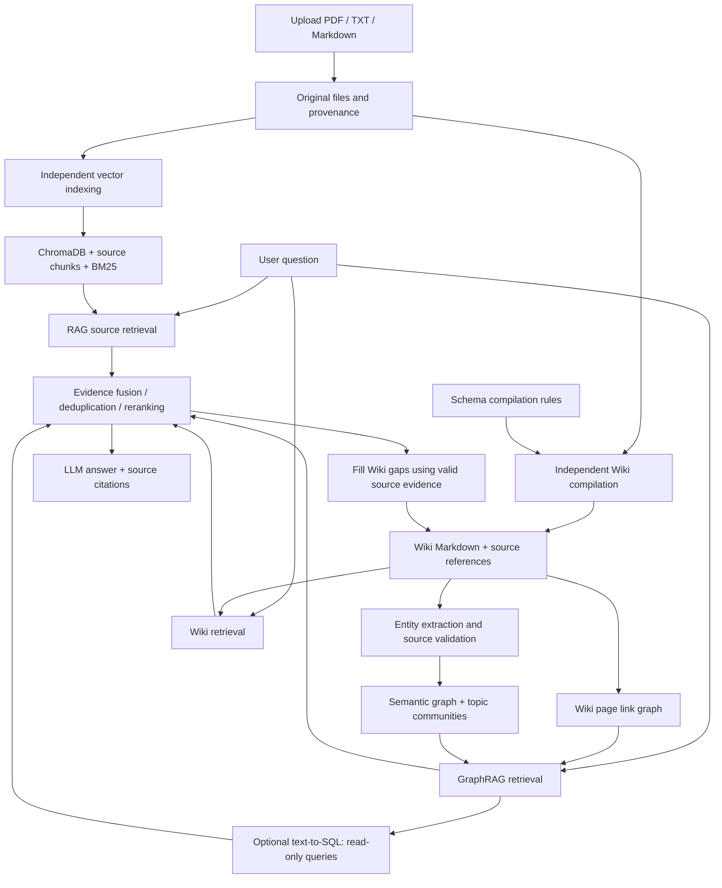

<div align="center">

<p>
  
</p>

<h1>MindPilot</h1>

<p><a href="README.md">简体中文</a> · <strong>English</strong></p>

<p><strong>Your personal knowledge copilot — turn scattered documents into knowledge you can ask about.</strong></p>

<p>Manage local documents and combine RAG, Wiki, and GraphRAG to retrieve, trace, connect, and visualize your knowledge.</p>

<p>
  <a href="#quick-start"></a>
  <a href="#how-it-works"></a>
  <a href="#local-data-and-model-requests"></a>
  <a href="#features"></a>
  <br>
  <a href="frontend/package.json"></a>
  <a href="backend/requirements.txt"></a>
  <a href="#project-structure"></a>
  <a href="#how-it-works"></a>
</p>

[Features](#features) · [Quick Start](#quick-start) · [How It Works](#how-it-works) · [Demo Notes](#screenshots-and-demo-notes) · [Project Structure](#project-structure)

</div>

---

## Sign In to Your Personal Knowledge Workspace

**Turn scattered documents into knowledge you can ask about.** Sign in with a local account to organize study notes, technical documents, and project materials, then develop them into searchable source text, structured Wiki content, and an explorable knowledge graph.


New users can select **Register Now (立即注册)** to create an account. Existing users can enter their username and password and optionally select **Remember Me (记住登录状态)**. Accounts and login state are managed by the local instance. When using remote models, the required questions and document excerpts are still sent to the corresponding provider.

After signing in, import your first document in the document center. Run vector indexing or Wiki compilation independently, then use the chat workspace below to ask questions with source evidence.


## What Is MindPilot?

MindPilot is an AI knowledge workspace for personal learning, technical research, and document organization. Import PDFs, Markdown, and text files, independently build vector indexes or compile Wiki content, and query your materials in natural language. Review the source text behind each answer and explore related knowledge through page links and entity relationships.

Document management, knowledge Q&A, graph exploration, and model evaluation share one interface. Documents can become reusable Wiki content, related concepts can form a graph, answers can become editable flowcharts, and retrieval quality can be checked using gold documents and test datasets.

**What can you use it for?**

- **Learning and reading:** organize textbooks, technical articles, and reading notes; explore concepts, methods, and dependencies.
- **Technical research:** compare perspectives across documents and verify conclusions against original passages.
- **Personal project libraries:** group plans, specifications, and records by knowledge domain; look up concrete steps and conditions.
- **RAG experiments:** compare embedding models, rerankers, chunk sizes, and Top-K settings, and save experimental results.
- **Knowledge presentation:** turn steps and structures into flowcharts or mind maps that you can edit and reuse.

## Highlights

| Highlight | What it enables |
| :--- | :--- |
| **Three retrieval paths** | RAG retrieves source chunks, Wiki retrieves compiled knowledge, and GraphRAG expands along page links and semantic relationships. Evidence is fused before answering. |
| **Independent indexing and compilation** | Uploading saves the original file. Run Wiki compilation or vector indexing first, with separate statuses for each. |
| **Traceable answers** | Citations identify documents and retrieval paths. Graph relationships retain source quotations, Wiki paragraphs, and provenance. |
| **Lightweight local storage** | SQLite, ChromaDB, Markdown, and JSON support personal deployments without separate Neo4j or PostgreSQL services. |
| **Knowledge that can be refined** | When a query exposes gaps in Wiki evidence, valid source passages can support background updates and subsequent incremental graph refreshes. |
| **Models organized by purpose** | Configure LLM, Embedding, Rerank, ASR, TTS, and Image separately, with category-specific model discovery and fuzzy search. |
| **Isolated evaluation workspace** | Manage gold documents, test datasets, retrieval configurations, and scores separately from your regular library; retain saved reports. |
| **Progress for long tasks** | News fetching, vector indexing, Wiki compilation, and graph construction run in the local backend. Switching pages does not actively cancel these tasks. |

## Features

### 1. Knowledge Q&A: Evidence from Sources, Wiki, and Graphs

Ask a question directly in chat. The backend retrieves source text and Wiki content in parallel, expands candidates through graph relationships, and fuses, deduplicates, and reranks the evidence before generating an answer. Citation badges identify the retrieval paths used in that turn, such as `RAG + Wiki + GraphRAG`.

The question used in the live demo, translated into English:

> Based on the Transformer, Embedding, and LangChain excerpts in my local documents, explain how vector retrieval helps a language model use a personal knowledge base. Answer in three points, within 400 Chinese characters, and cite the original sources.

The answer, citations, and three follow-up cards below came from an actual run. Follow-up questions are generated alongside the answer and displayed when it finishes. These cards belong only to the new reply: they are not saved as chat messages and do not reappear when reopening a conversation.


Chat also provides **Deep Thinking (深度思考)** and **Run Monitor (运行监控)**. Deep Thinking adds an answer-review workflow; Run Monitor shows orchestration, retrieval, generation, and tool execution. Use citations and run details to check the answer.

### 2. Documents: Upload, Index, and Compile Separately

The document center supports **PDF / TXT / Markdown**, with a maximum file size of **50 MiB**. Select a knowledge domain, search documents, change sorting, perform batch operations, and preview source chunks and associated Wiki content.

Uploading does not immediately invoke a model. The original file is saved locally, and you choose how to process it afterward.


| Operation | Processing | Status |
| :--- | :--- | :--- |
| **Vector indexing** | Extract text, split chunks, call an embedding model, and build a local vector index | Not indexed → Processing → Indexed |
| **Wiki compilation** | Read source text directly and organize its structure, factual citations, and `[[wikilink]]` links | Not compiled → Compiling → Compiled |
| **Preview** | Inspect summaries, source chunks, Wiki Markdown, and provenance | Does not modify the original document |

In the demo, the Embedding document completed both indexing and compilation. Transformer and LangChain completed compilation while remaining unindexed, demonstrating the two independent workflows.


If an original file is missing, the interface explicitly asks you to upload it again. An existing vector index cannot replace the original file as the factual basis for Wiki compilation.

### 3. Wiki: Compile Source Documents into Cited Markdown

Wiki compilation reads the original file, splits it by structure or length, and asks an LLM to organize an overview, key knowledge, related concepts, and uncertainties. References such as `[S1]` link facts to source passages; `[[wikilink]]` links connect concepts.

The Schema layer controls compilation rules, stored by default in `.mindpoilt/wiki_schema/SCHEMA.md`. Original files remain unchanged; generated content is stored separately as Wiki Markdown and metadata.

Select **Related Wiki (关联Wiki)** in a document preview to inspect the compiled result:


Initial compilation currently produces a Wiki draft for each document. A `[[concept name]]` link does not mean a standalone page already exists for that concept. Missing or ambiguous targets are reported in the visualization interface for later cleanup.

### 4. Knowledge Visualization: Page Links and Semantic Relationships

The visualization page presents two levels of knowledge relationships:

| Graph layer | Nodes and edges | Purpose |
| :--- | :--- | :--- |
| **Wiki page graph** | Wiki pages, outgoing links, and backlinks; unresolved targets appear as dashed nodes | Navigate related pages, find broken links, and expand across documents |
| **Semantic knowledge graph** | People, organizations, products, concepts, and relationships such as “based on,” “depends on,” “contains,” and “proposed by” | Query explicit relationships and dependencies, and locate their source evidence |

Select **Build / Update Graph (构建 / 更新图谱)** to extract entities and relationships from valid Wiki content and its source evidence. The backend validates quotations, merges candidate entities, and forms topic communities. After the first build, Wiki changes trigger incremental updates.

The three book excerpts in this demo produced **61 entities, 62 semantic relationships, and 11 topic communities**. These counts describe this run only; they are not accuracy or performance scores.


Search pages, entities, aliases, or relationship types; pan and zoom the canvas; click nodes or relationships to inspect evidence. Below is the result of filtering by `Transformer`, along with related topic communities:


**SQLite manages graph state and indexes; JSON stores exportable graph snapshots.** No separate graph database is required. Model extraction and literal quotation checks do not replace human fact review, particularly when PDF extraction order, aliases, or relationship meanings are ambiguous.

### 5. Natural-Language Graph Queries: Text → Read-Only SQL → Evidence

Enter a question in the visualization page, for example:

> Which concepts are based on Transformer? List their relationships with Transformer.

The system generates parameterized SQL and executes it against an isolated SQLite snapshot of the current user's valid graph. It displays the SQL, bound parameters, results, and source passages found through graph expansion. Generated SQL does not access account, chat, or other business databases directly, and this interface cannot write data.


Select **View Source (查看来源)** to inspect the original evidence. Even an unindexed document can provide traceable evidence through valid source quotations saved during Wiki compilation.


If SQL generation fails, is rejected, or returns no matches, the system attempts keyword matching and graph expansion. Graph paths guide knowledge navigation; factual claims still need original evidence.

### 6. Daily News: Fetch, Read, Edit, and Add to Your Library

Daily News fetches items for your topics of interest, prioritizing today's news and expanding to the most recent preceding days when needed. Items are displayed from newest to oldest. Related webpages can be consolidated around a common topic while retaining source links.

Search titles, bodies, or tags; filter read/unread items; use pagination and batch operations. Synchronization displays its current stage and a **Running in Background (后台运行中)** indicator. Leaving the page does not interrupt the task while the local backend remains running.


The detail view includes a summary, full body, original sources, editing, and **Save to Documents (保存到知识资料)**. Saving creates a Markdown document in the normal library. You can then choose indexing or Wiki compilation rather than automatically promoting every news item into indexed knowledge.


*These screenshots show existing news items assembled from online search and their interface. Individual news claims were not reverified while preparing the documentation. Open original sources to check content and publication dates.*

### 7. Model Configuration: Choose by Purpose and Search Lists

Open **Model Configuration (模型配置)** from the account menu in the lower-left corner. Models are organized into six categories:

| Category | Purpose |
| :--- | :--- |
| **LLM** | Q&A, Wiki compilation, relationship extraction, graph SQL generation, and some evaluation tasks |
| **Embedding** | Source indexing and semantic retrieval |
| **Rerank** | Reranking candidate passages |
| **ASR / TTS** | Speech recognition and synthesis; see the voice section below |
| **Image** | Image-generation capabilities |

Provider options include DeepSeek, Alibaba Cloud Model Studio, Kimi, Volcengine, Zhipu, and custom compatible endpoints. Available capabilities depend on the configured provider interface and model.

**Saving configuration and enabling a model are separate actions.** Each category has one active model at a time. Complete saved configurations take effect without a restart. Saved credentials are masked in both forms and JSON previews.


Select **Fetch Model List (获取模型列表)** to retrieve candidates for the current category. The dropdown supports fuzzy search and manual model names. Only the icon rotates while loading; the button text stays unchanged. Retrieved lists can be reopened within the same configuration page without fetching them each time.

The demo retrieved **15 embedding models** from the configured Alibaba Cloud endpoint. Searching for `qwen` reduced the list to four:


After changing an embedding model or its vector dimensions, rebuild the corresponding indexes so that document vectors remain consistent with the new configuration.

### 8. LLM Comparison: The Same Input, Side-by-Side Models

Open **Model Comparison (模型对比测试) → LLM Performance Comparison (LLM 性能对比)** from the account menu. Choose multiple models from one provider or across providers, and set the question, system prompt, output limit, temperature, and concurrency.

Results show answers, reasoning when available, time to first answer text, total duration, output tokens, and output rate. Retry individual models, save results, and open or download reports from **Saved Results (已保存结果)**. Tests do not change the model used for everyday chat.


*This screenshot restores a previously saved single-question run using `deepseek-flash` and `deepseek-v4-pro`. Timing depends on the prompt, network, output length, and provider conditions; it does not establish which model is better across all tasks.*

### 9. RAG Evaluation: Check Retrieval and Then Answer Support

The RAG lab uses a test workspace isolated from the regular library, with three steps: **Dataset and Gold Annotations → Comparison Configurations → Results and Relevance Review**.

Combine embedding models, rerankers, chunk sizes, and Top-K settings to compare retrieval. Use gold answers and source evidence to inspect generation quality.


**Retrieval metrics**

| Metric | What it measures |
| :--- | :--- |
| **Recall@K** | The proportion of gold-relevant documents retrieved, revealing missed documents |
| **Document Precision@K** | The proportion of relevant documents in the first K results |
| **Chunk Precision@K** | The proportion of relevant retrieved chunks, reported separately from document precision |
| **MRR@K** | The reciprocal rank of the first relevant result |
| **nDCG@K** | Ranking quality using relevance grades and position discounts |
| **Hit Rate@K** | The proportion of questions with at least one relevant hit |
| **Annotation / evidence coverage** | Whether scoring is supported by sufficient annotations and gold evidence |

**Generation consistency metrics**

| Metric | What it measures |
| :--- | :--- |
| **Faithfulness · Factual Support** | Whether the answer's factual claims are supported by retrieved material |
| **Semantic Faithfulness · Cosine** | Embedding similarity between the answer and retrieved material; reported separately, not treated as factual correctness |
| **Groundedness · Dual Signal** | Sentence-level semantic similarity or literal evidence, reducing false alarms for short answers |
| **Factual Consistency** | A judge model's assessment of facts against the context |
| **Potential Hallucination Rate** | A risk indicator based on the proportion of insufficiently grounded sentences |
| **Reference Consistency / Fact Recall** | Agreement with the gold reference answer and coverage of its key facts |

The interface provides reference bands for excellent, good, and needs-improvement scores, plus metric definitions. Missing or incomplete evaluation conditions are not filled with invented scores.


**Save and review:** select **Save Evaluation Results (保存评测结果)** to retain a report. Restore it from Saved Results or download JSON. Retrieval metrics can be recalculated after annotations change; older reports retain the original data and scoring versions.

*The screenshot restores an existing three-question generation evaluation on a small synthetic sample. It is not a full 144-question benchmark. High scores here do not imply equivalent performance on real business documents or arbitrary libraries. The test workspace expires after 24 hours of inactivity; export important datasets and save reports separately.*

### 10. Gold Documents and Test Datasets: Visual Management and Editing

**Gold Documents (黄金文档)** has a dedicated view for browsing documents and pages, editing names and text, saving, and deleting. Changes to source text clear old evidence offsets and mark annotations for review, preventing outdated positions from being scored.


**Test Dataset (测试集)** has a separate view for questions, reference answers, development/test splits, document relevance grades, and gold evidence, supporting repeatable evaluation.

The project includes a synthetic sample with **12 gold documents, 72 pages, and 144 questions** to introduce the workflow. The sample organization, “星桥实验企业” (Starbridge Experimental Enterprise), is fictional; its policies apply only within that test corpus. Use your actual documents and reviewed annotations for substantive evaluation.


### 11. Conversation Map: Organize Dialogues into Workspaces

The conversation map manages **relationships between conversations**, separately from the document graphs in Knowledge Visualization. Create workspaces, organize conversation cards, connect ideas, and open a card to continue its dialogue.


The conversation created for this demo, “向量检索助知识库” (Vector Retrieval for a Knowledge Base), remains in the local account. Other visible conversations are existing local records and are not distributed with the public source repository.

### 12. Editable Outputs: Turn Answers into Diagrams

Type `/` to open the capability panel. Choose knowledge Q&A, paper comparison, concept tracing, technical research, Wiki organization, or flowchart, mind-map, and poster-design entries.


The demo generated a flowchart from the book excerpts' knowledge-Q&A steps. Preview or download the diagram card, or open the locally integrated draw.io editor without leaving the page.


The poster-design entry provides design, rendering, and quality-review workflows. It can incorporate uploaded images, produce HTML, and export PNG / PDF. This documentation shows its actual entry but did not run an additional poster-generation task. Image and poster capabilities require their associated models or runtime dependencies.

### 13. Voice Interaction — Description Only

MindPilot provides voice input, a real-time call entry, and answer read-aloud. ASR and TTS configurations control recognition and synthesis respectively.

- Retrieve ASR / TTS model lists by category using the configured endpoints and credentials.
- TTS voices are associated with the selected model. Search by voice name or ID and preview or pause playback on supported interfaces.
- Voice selection and speech models are managed separately from the everyday text model. Provider-native speech protocols and compatible text protocols are not interchangeable.
- Recording requires browser microphone permission and supported models, voices, and provider protocols.

**No recording, real-time calls, or voice previews were performed for this documentation.** This section describes the functionality only.

## How It Works

### Three Knowledge Layers

| Layer | Stored content | Responsibility |
| :--- | :--- | :--- |
| **Raw Sources** | Original files, extracted text, citable chunks, and source fingerprints | Factual baseline; RAG locates original passages |
| **Wiki Layer** | Markdown with source IDs, key knowledge, and `[[wikilink]]` links | Distill, organize, and connect existing material |
| **Schema Layer** | Compilation rules, structure, and quality constraints | Constrain generation and preserve sources, conditions, and uncertainty |

“Raw Sources” is a logical layer. Uploaded files are actually stored in `backend/data/documents/`; you do not need to create a `raw/` directory manually.

### How the Three Retrieval Paths Work Together



- **RAG** locates concrete source passages using **ChromaDB vector retrieval + BM25 + rank fusion**. An available reranker further adjusts candidate order.
- **Wiki** retrieves knowledge already organized from your documents. Valid compiled content and its source references can be retrieved even before vector indexing.
- **GraphRAG** explores connections through page links, semantic relationships, and community summaries, with limits on hops and candidate counts.
- **The fusion layer** combines retrieved material into evidence, preserves source labels, and schedules source-based Wiki updates after the answer. The generated answer itself is not treated as a new factual source.

Retrieval paths can fall back when unavailable. Source badges indicate the paths that actually contributed in the current turn. Graph SQL runs only on an isolated graph snapshot; final answers must still be traceable to valid original material.

## Quick Start

### Environment and Dependencies

The local demo used **Windows, Python 3.13.5, and Node.js 22.20.0**. Install backend dependencies in a Python virtual environment and frontend dependencies with npm.

SQLite and ChromaDB provide local storage by default, with no separate database service to start. Q&A, compilation, graph extraction, and remote embedding require your own model configuration. Online news also requires search-service configuration.

### 1. Start the Backend

Open a terminal at the project root:

```powershell
cd backend
python -m venv .venv
.venv\Scripts\Activate.ps1
python -m pip install -r requirements.txt
python -m uvicorn app.main:app --host 127.0.0.1 --port 8000 --reload
```

If PowerShell prevents activation scripts from running, use the virtual environment's Python directly, from the `backend` directory:

```powershell
.venv\Scripts\python.exe -m pip install -r requirements.txt
.venv\Scripts\python.exe -m uvicorn app.main:app --host 127.0.0.1 --port 8000 --reload
```

Health check: `http://127.0.0.1:8000/health`. API documentation: `http://127.0.0.1:8000/docs`.

### 2. Start the Frontend

Open a second terminal at the project root:

```powershell
cd frontend
npm ci
npm run dev
```

Open the Vite address printed in the terminal, usually `http://localhost:5173`. The frontend proxies `/api` requests to local port `8000` by default.

### 3. First-Time Setup

1. **Create your own account.** The public repository contains no local accounts or login sessions.
2. **Configure models.** Account menu → Model Configuration; enter your endpoints, credentials, and model names, save, then enable each required category.
3. **Import documents.** Documents → Import Documents; select PDF, TXT, or Markdown and a knowledge domain.
4. **Choose processing.** Use vector indexing for source-vector retrieval or Wiki compilation for structured organization; the workflows are independent.
5. **Build the graph.** Once Wiki content exists, select Build / Update Graph in Knowledge Visualization.
6. **Ask questions.** Review answers, citations, and source labels, and inspect original passages when necessary.
7. **Evaluate and reuse.** Compare models and retrieval configurations in the RAG lab, and save useful results.

The current application interface and the screenshots are in **Simplified Chinese**. This English README translates the documentation, not the application UI; key controls above include their Chinese labels for navigation.

### 4. Build and Development Checks

```powershell
# From the frontend directory
npm run build
```

```powershell
# From the backend directory, using your Python virtual environment
python -m pip install -r requirements-dev.txt
python -m pytest -q
```

The frontend build produces `frontend/dist/`. A successful build does not automatically deploy the application, and the development-server defaults are not a public deployment configuration.

## Local Data and Model Requests

| Location | Content | Included in the public source copy? |
| :--- | :--- | :--- |
| `backend/data/` | Account database, original documents, vector indexes, Wiki, graphs, and evaluation reports | No; created at runtime |
| `.mindpoilt/` | Model configuration, conversation state, events, context, memory, and compilation rules | No; created at runtime |
| `docs/images/` | Reviewed screenshots used in this README | Yes |
| `frontend/vendor/drawio/` | Locally integrated third-party editor source and license files | Yes |

Local file storage **does not mean model processing is entirely offline**. Remote LLM, embedding, reranking, speech, and search services receive the questions, passages, audio, or keywords needed for the request. When configuring compatible local services, available capabilities depend on the interfaces those services support.

This source copy excludes `artifacts/`, personal databases, original PDFs, model credentials, login tokens, and complete conversation histories. Screenshots use actual local data, with endpoint addresses and credentials masked and the account display name hidden. Published images still show the document titles, short excerpts, and portions of conversation content visible in them.

Do not force-add runtime `.mindpoilt/`, `backend/data/`, or personal `.env` files to Git. Protect runtime data separately when backing up a personal instance.

## Screenshots and Demo Notes

The screenshots were captured through **actual local browser operations on October 12, 2026**. They are not mockups or fabricated results. A fresh checkout does not include the depicted personal documents or saved results.

| Area | What was actually performed |
| :--- | :--- |
| Source preparation | Extracted selected passages from PDF file pages 39–40, 170, and 178–180 of an existing 202-page local book, 《大模型应用开发极简入门：基于 GPT-4 和 ChatGPT》 (2024; roughly “A Minimal Introduction to Large Language Model Application Development with GPT-4 and ChatGPT”), and organized them into Transformer, Embedding, and LangChain Markdown files. |
| Import and indexing | Selected and uploaded all three files through the document-import interface; indexed Embedding, producing two chunks. |
| Wiki | Compiled all three excerpts using the configured model, preserving `[S-number]` citations and `[[wikilink]]` links. |
| Graph | Ran the actual relationship-extraction, source-validation, and community workflow, producing 61 entities, 62 relationships, and 11 communities; queried Transformer relationships and opened source evidence. |
| Q&A and outputs | Asked a knowledge-base question, obtained an answer with three-path source labels and follow-up cards, then generated a flowchart and opened the draw.io editor. |
| Model configuration | Retrieved the Alibaba Cloud embedding-model list and filtered it with `qwen`, without changing the active model. |
| News | Opened existing local news lists and details; did not rerun long news synchronization for screenshots. |
| Evaluation | Restored a saved real two-model DeepSeek comparison and a three-question RAG generation report, and opened gold-document and 144-question dataset management. Historical results are not presented as newly executed benchmarks. |
| Voice | Description only; no recording, calls, or playback previews. |

The excerpts were prepared to keep the demo manageable and are not distributed with the source. Cross-document reading links were added manually and explicitly labeled as navigation rather than facts from the book. PDF references use file page numbers; uploaded Markdown documents have their own page numbering.

## Project Structure

```text
MindPilot/
├── backend/
│   ├── app/
│   │   ├── agents/          # Q&A, orchestration, and review workflows
│   │   ├── api/             # Accounts, documents, chat, models, evaluations, graphs
│   │   ├── core/            # Configuration, security, and local storage layout
│   │   ├── db/              # SQLite models and database management
│   │   ├── services/        # Document processing, Wiki, graph, model, evaluation services
│   │   └── tools/           # Knowledge retrieval, online search, and other tools
│   ├── tests/
│   └── requirements.txt
├── frontend/
│   ├── src/
│   │   ├── api/             # Backend requests and streaming interfaces
│   │   ├── components/      # Chat, configuration, evaluation, graph, editor components
│   │   ├── stores/          # Conversation, account, and UI state
│   │   └── views/           # Documents, chat, conversation map, knowledge visualization
│   └── vendor/drawio/       # Third-party draw.io editor
├── docs/images/             # Actual operation screenshots
├── GRAPH_RAG_DESIGN.md
├── WIKI_THREE_LAYER_DESIGN.md
├── RAG_EVALUATION_DESIGN.md
├── SESSION_MEMORY_DESIGN.md
├── README.en.md             # English documentation
└── README.md                # Simplified Chinese documentation
```

---

## Keep Your Knowledge Growing

We hope MindPilot becomes a lasting companion for learning and exploration: helping you trace what you have read, connect each question to existing knowledge, and gradually turn scattered ideas into a knowledge network of your own.

The project continues to evolve. We welcome your experiences, feature suggestions, and contributions through Issues and Pull Requests. If MindPilot helps you, consider giving the project a Star to support its continued development.

Thank you to every user and contributor, and to the open-source communities that make this project possible.

**Start with one document. Let every exploration add to what you know.**
