<div align="center">

<p>
  
</p>

<h1>MindPilot</h1>

<p><strong>简体中文</strong> · <a href="README.en.md">English</a></p>

<p><strong>智能知识管家 · 让散落的资料，变成随时可问的知识。</strong></p>

<p>管理本地资料，融合 RAG、Wiki 与 GraphRAG，让知识可以检索、追溯、关联与可视化。</p>

<p>
  <a href="#快速开始"></a>
  <a href="#工作原理"></a>
  <a href="#本地数据与模型调用"></a>
  <a href="#功能介绍"></a>
  <br>
  <a href="frontend/package.json"></a>
  <a href="backend/requirements.txt"></a>
  <a href="#项目结构"></a>
  <a href="#工作原理"></a>
</p>

[功能介绍](#功能介绍) · [快速开始](#快速开始) · [工作原理](#工作原理) · [实操记录](#截图与实操记录) · [项目结构](#项目结构)

</div>

---

## 从登录开始，开启你的个人知识工作台

**让散落的资料，变成随时可问的知识。** 从本地账号登录开始，把学习笔记、技术文档与项目资料集中管理，逐步整理成可检索的原文、结构化 Wiki 和可探索的知识图谱。

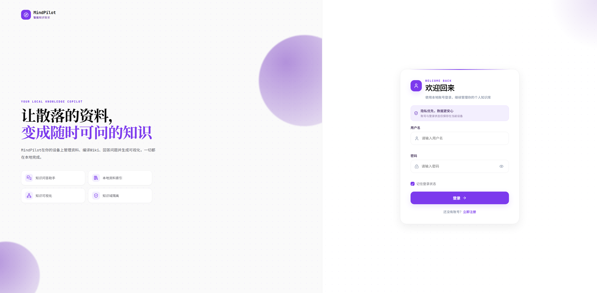

首次使用点击 **“立即注册”** 创建账号；已有账号输入用户名和密码即可登录，也可以勾选 **“记住登录状态”**，方便下次继续整理资料与对话。账号与登录状态由本地实例管理；使用远程模型时，所需的问题和资料片段仍会发送给对应服务商。

登录后，你可以从知识资料导入第一份文档，独立执行向量化或 Wiki 编译，再进入下面的问答工作台，让每一次提问都能找到资料依据。

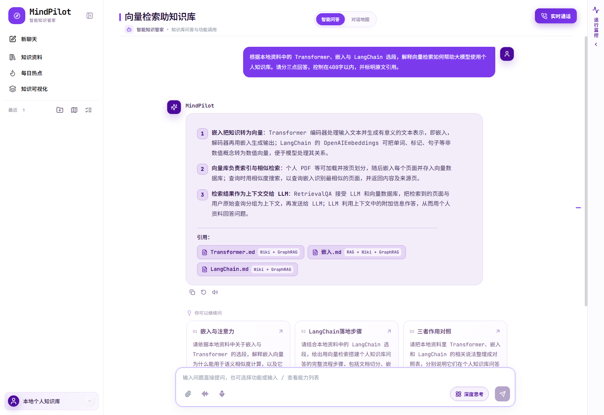

## MindPilot 是什么？

MindPilot 是面向个人学习、技术研究和资料整理的 AI 知识工作台。你可以导入 PDF、Markdown 和文本，独立建立向量索引或编译 Wiki，再通过自然语言查询这些资料，查看答案所依据的原文，并沿页面链接与实体关系探索相关知识。

它把资料管理、知识问答、图谱探索和模型评测放在同一个界面中：读过的资料可以沉淀为 Wiki，相关概念可以形成图谱，问答结果可以转成可编辑的流程图，而检索质量可以通过黄金文档和测试集持续检查。

**适合用来做什么？**

- **学习与阅读**：整理教材、技术文章和阅读笔记，问清概念、方法与依赖关系。
- **技术调研**：在多份资料之间对比观点，通过原文引用核对结论。
- **个人项目资料库**：将方案、规范与记录按知识域归类，查询具体步骤和条件。
- **RAG 实验**：比较不同 Embedding、Reranker、分块大小与 Top-K 配置，保存实验结果。
- **知识表达**：把问答中的步骤与结构整理成流程图、思维导图，继续编辑和复用。

## 有哪些特色？

| 特色 | 带来的变化 |
| :--- | :--- |
| **三路知识检索** | RAG 查原文分块，Wiki 查整理后的知识，GraphRAG 沿页面与语义关系扩展；统一融合证据后回答。 |
| **向量化与 Wiki 编译独立** | 上传只保存原始文件。可以先编译 Wiki，也可以先向量化，两种状态分别展示。 |
| **答案可以回到来源** | 引用显示文档与检索来源；图谱关系保留原文引句、Wiki 段落和来源信息。 |
| **轻量本地存储** | 使用 SQLite、ChromaDB、Markdown 与 JSON，个人部署不需要另装 Neo4j 或 PostgreSQL。 |
| **知识可持续整理** | 查询发现 Wiki 依据不足时，可基于有效原文在后台补充 Wiki；已构建图谱随后增量更新。 |
| **模型按用途配置** | LLM、Embedding、Rerank、ASR、TTS、Image 分开选择；支持按类别获取模型并模糊搜索。 |
| **评测与日常资料隔离** | 黄金文档、测试集、检索方案与评分在实验空间管理，保存的评测报告可长期查看。 |
| **长任务有进度** | 热点获取、向量化、Wiki 编译、图谱构建由本地后端执行，切换页面不会主动取消这些任务。 |

## 功能介绍

### 1. 知识问答：原文、Wiki 与图谱共同提供证据

在聊天界面直接提问。后台并行检索原文与 Wiki，并通过图关系扩展候选资料，融合、去重与重排后交给模型回答。引用标签会显示本轮命中的来源，例如 `RAG + Wiki + GraphRAG`。

本次实操提问：

> 根据本地资料中的 Transformer、嵌入与 LangChain 选段，解释向量检索如何帮助大模型使用个人知识库。请分三点回答，控制在400字以内，并标明原文引用。

下面的答案、引用和三张追问卡片均来自实际运行。追问问题与回答并行生成，在本轮回答结束后显示；只属于当前新回复，不会作为历史消息保存，重新打开会话时不会重放这些卡片。

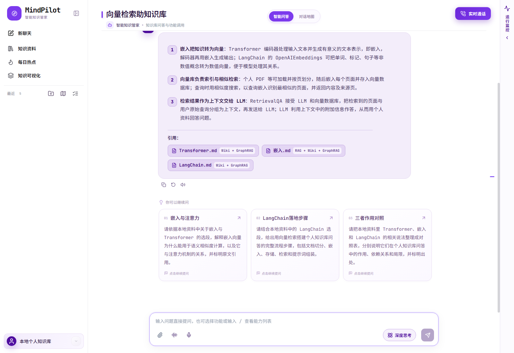

聊天还提供“深度思考”和“运行监控”入口。深度思考增加回答检查流程；运行监控用于查看调度、检索、生成与工具执行情况。可以结合引用和运行详情核对答案。

### 2. 知识资料：上传、向量化、Wiki 编译分别执行

资料中心支持 **PDF / TXT / Markdown**，单个上传文件最大 **50 MiB**。可以选择知识域、搜索资料、调整排序和批量处理，并查看原文分块与关联 Wiki。

上传不会立即调用模型：原始文件先保存到本地，再由你选择后续处理。

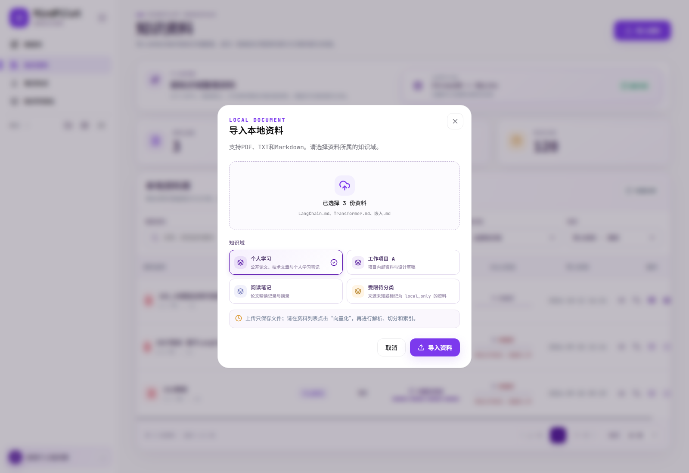

| 操作 | 处理内容 | 列表状态 |
| :--- | :--- | :--- |
| **向量化** | 提取文本、切分分块、调用 Embedding、建立本地向量索引 | 未向量化 → 处理中 → 向量化完成 |
| **Wiki 编译** | 直接读取原始文本，按规则整理结构、事实引用与 `[[wikilink]]` | 未编译 → 编译中 → 编译完成 |
| **预览** | 查看资料摘要、原文分块、Wiki Markdown 与来源 | 不改变原始资料 |

实操中，“嵌入”同时完成了向量化和编译；“Transformer”“LangChain”完成编译，保持未向量化，展示了两条独立流程。

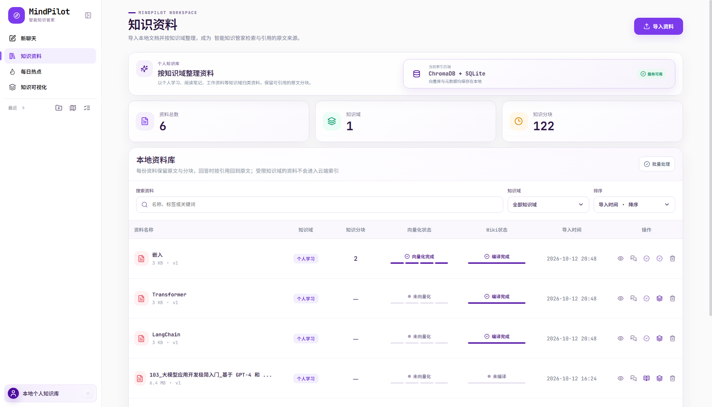

原始文件缺失时，界面会明确显示需要重新上传。已有向量索引不能替代原始文件成为 Wiki 编译的事实基准。

### 3. Wiki：把原始资料整理成带来源的 Markdown

Wiki 编译直接读取原始文件，按结构或长度切分，再由 LLM 整理概述、关键知识、相关概念与不确定性。事实通过 `[S1]` 等编号关联原始片段；概念之间用 `[[wikilink]]` 连接。

编译规则由 Schema 层管理，默认保存在 `.mindpoilt/wiki_schema/SCHEMA.md`；原始文件保持不变，生成内容写入独立的 Wiki Markdown 与元数据。

在资料预览中选择 **“关联Wiki”**，即可查看实际编译结果：

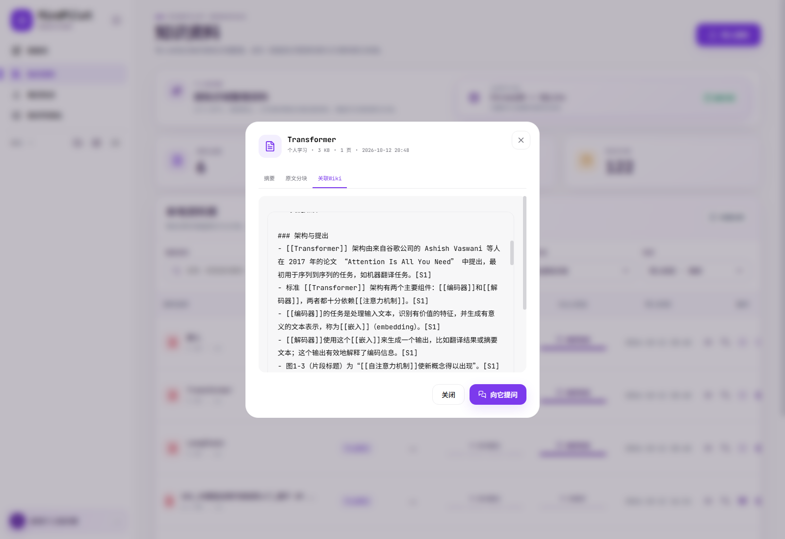

当前初始编译以每份资料对应的 Wiki 初稿为主要产出。出现 `[[概念名]]` 不代表该概念已拥有独立页面：未创建或存在歧义的链接会在可视化界面提示，方便后续整理。

### 4. 知识可视化：页面关联图与语义知识图谱

这里展示两种不同层次的知识关系：

| 图的层次 | 节点与边 | 用途 |
| :--- | :--- | :--- |
| **Wiki 页面图** | Wiki 页面、出链与反向链接；未解析目标显示为虚线节点 | 导航相关页面，发现断链，扩展跨文档资料 |
| **语义知识图谱** | 人物、组织、产品、概念等实体，以及“基于 / 依赖 / 包含 / 提出”等关系 | 查询明确的关系与依赖，沿关系定位原文证据 |

点击 **“构建 / 更新图谱”**，后台从有效 Wiki 与其原文依据中抽取实体和关系，校验引句，合并候选实体，并形成主题社区。首次构建后，Wiki 内容变化会触发增量更新。

本次三份书籍选段实际生成了 **61 个实体、62 条语义关系和 11 个主题社区**。这些数字仅描述这次实操，不代表图谱准确率或性能成绩。

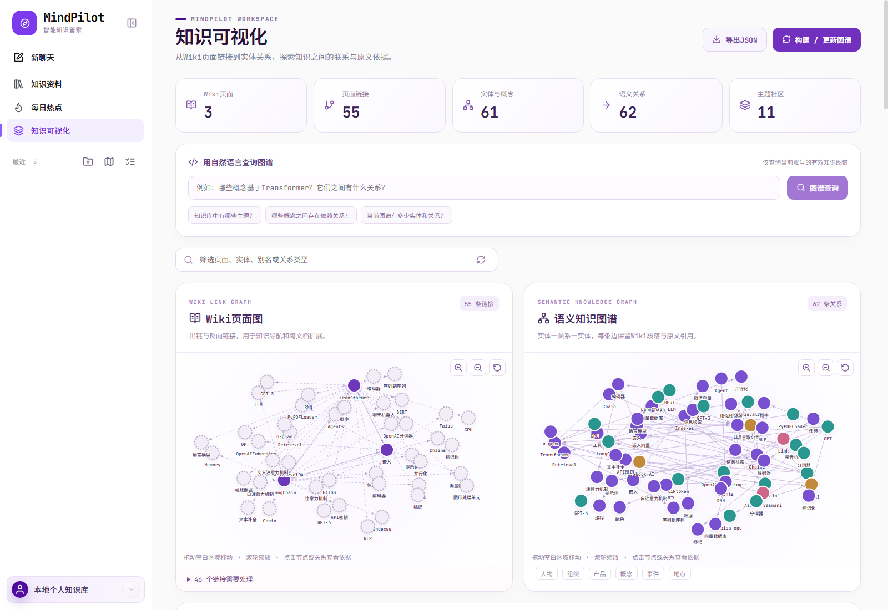

可以搜索页面、实体、别名和关系类型，拖动画布、缩放，点击节点或关系查看依据。下面是实际输入 `Transformer` 后的局部图，以及相关主题社区：

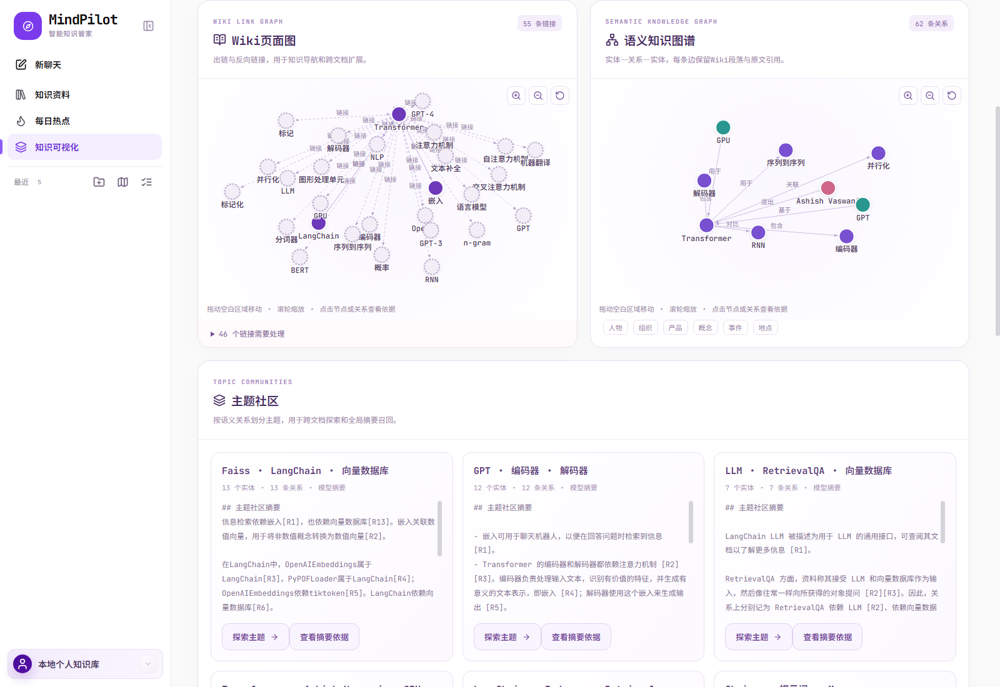

图谱使用 **SQLite 管理状态与索引，JSON 保存可导出的图快照**，无需独立图数据库。模型抽取与字面引用校验不能替代人工事实复核，尤其是存在 PDF 提取错位、别名或关系歧义时。

### 5. 自然语言查询图谱：文本 → 只读 SQL → 原文依据

在知识可视化页面输入问题，例如：

> 哪些概念基于 Transformer？请列出它们与 Transformer 的关系。

系统生成参数化 SQL，在当前用户有效图谱的隔离 SQLite 快照上执行，展示查询语句、绑定参数、结果与图扩展命中的原文片段。生成 SQL 不直接接触账号、聊天或其他业务数据库；不能通过该入口写入数据。

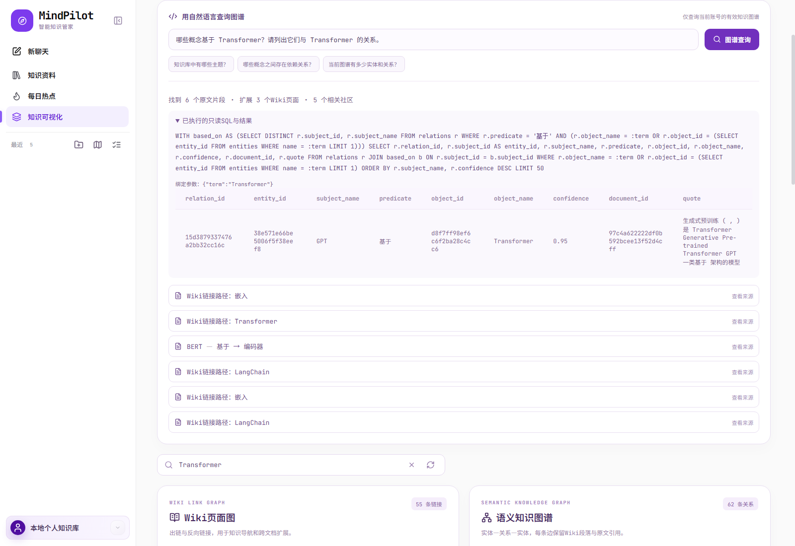

点击 **“查看来源”** 可以回到原始证据。即使资料尚未向量化，Wiki 编译时保存的有效原文引用也可以用于追溯。

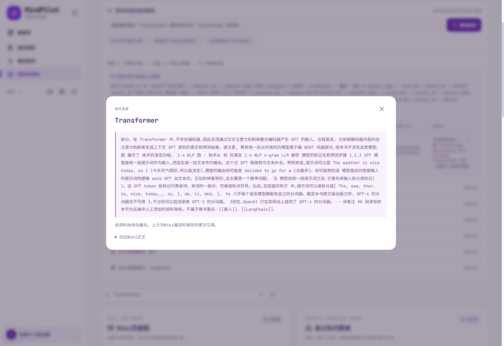

SQL 生成失败、被拒绝或没有命中时，会尝试关键词与图关系扩展；图谱路径是知识导航线索，最终事实仍需原始证据支撑。

### 6. 每日热点：获取、阅读、编辑并沉淀到资料库

每日热点按个人关注主题获取新闻，优先搜索当天，数量不足时再向最近几天扩展；列表按时间从近到远展示。相关网页可以围绕同一主题合并整理，保留来源链接。

页面支持标题、正文或标签搜索，已查看 / 未查看筛选、分页与批量处理。点击同步后会显示获取阶段和 **“后台运行中”** 提示；只要本地后端仍在运行，离开该页面不会中断获取任务。

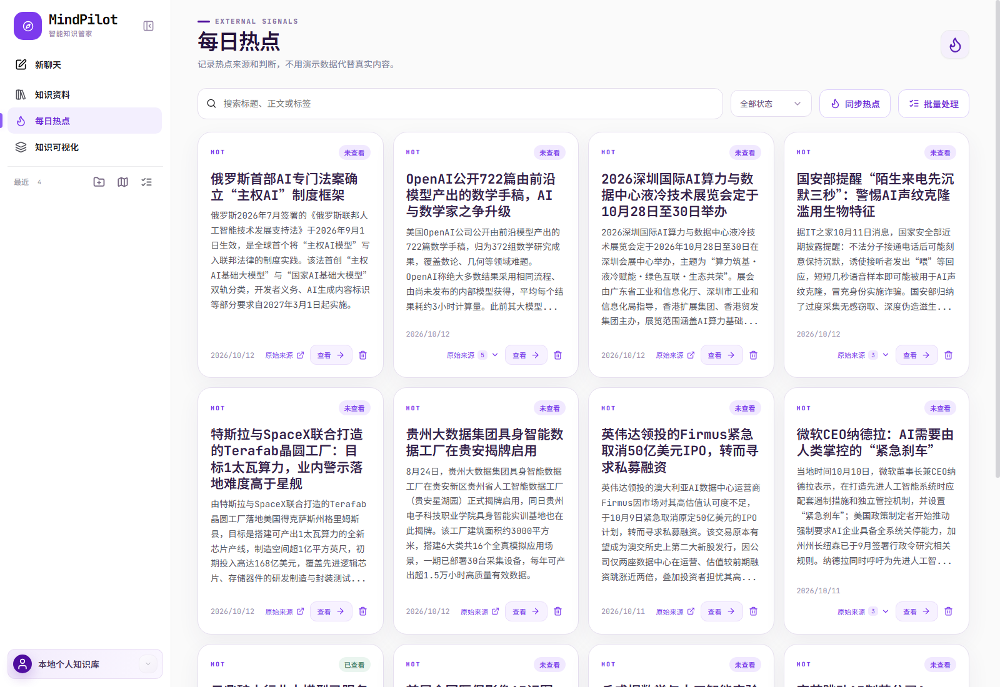

详情提供摘要、正文、原始来源、编辑与 **“保存到知识资料”**。保存时生成 Markdown 文件，进入正常资料列表；之后仍可自行选择向量化、Wiki 编译，避免自动把所有新闻变成正式知识。

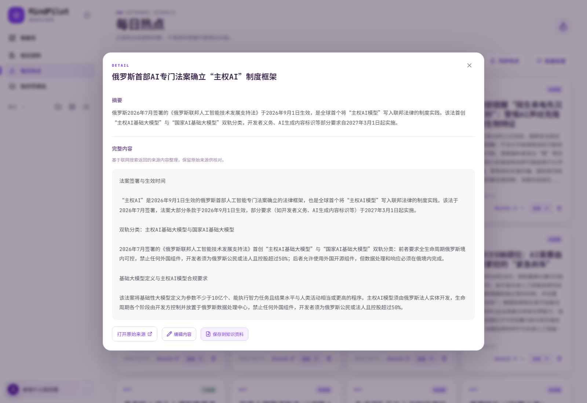

*截图展示本机已有的联网整理条目和操作界面，并未在制作文档时重新核验各条新闻事实。使用时可以打开原始来源核对内容与发布时间。*

### 7. 模型配置：按用途选模型，搜索列表更方便

从左下角个人中心打开 **“模型配置”**，按六类用途设置：

| 类别 | 用途 |
| :--- | :--- |
| **LLM** | 问答、Wiki 编译、关系抽取、图谱 SQL 生成与部分评测 |
| **Embedding** | 原文向量化与语义检索 |
| **Rerank** | 候选片段重排 |
| **ASR / TTS** | 语音识别与合成，见后面的语音说明 |
| **Image** | 图像生成相关能力 |

支持 DeepSeek、阿里云百炼、Kimi、火山引擎、智谱及自定义兼容接口。不同厂商和用途的具体可用能力，以已配置接口与模型为准。

**保存配置与启用模型分开**，每个类别同时启用一个模型；完整配置保存后无需重启。已保存的密钥在界面与 JSON 预览中脱敏。

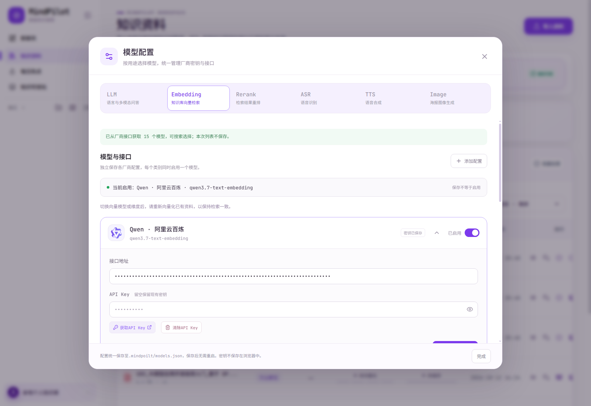

点击 **“获取模型列表”** 按当前类别获取候选模型；下拉框可以模糊搜索，也可以手动填写名称。加载时只旋转图标，按钮文字不变；本次页面中的已获取列表可以重复打开，无需每次重新请求。

实操从已配置的阿里云接口获取到 **15 个 Embedding 模型**，输入 `qwen` 后筛选出四个：

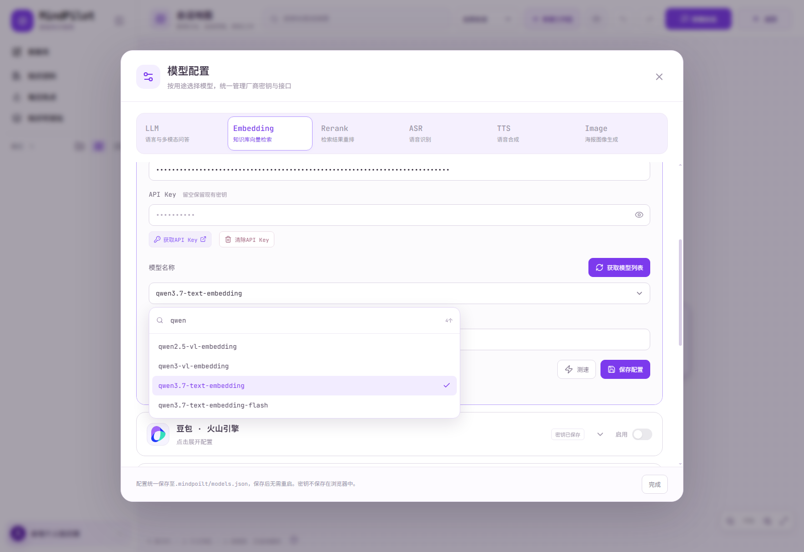

更换 Embedding 模型或向量维度后，需要让资料索引与新配置保持一致，重新建立相应向量索引。

### 8. LLM 性能对比：相同输入，多模型并排观察

从个人中心打开 **“模型对比测试” → “LLM 性能对比”**。可以选择同一厂商的多个型号或不同厂商模型，设置测试问题、系统提示词、输出长度、温度与并发数量。

结果展示回答、可用的思考过程、首字耗时、总耗时、输出 Token 和输出速率；可以单独重试、保存测试结果，并从 **“已保存结果”** 查看或下载报告。测试不会切换日常使用的模型。

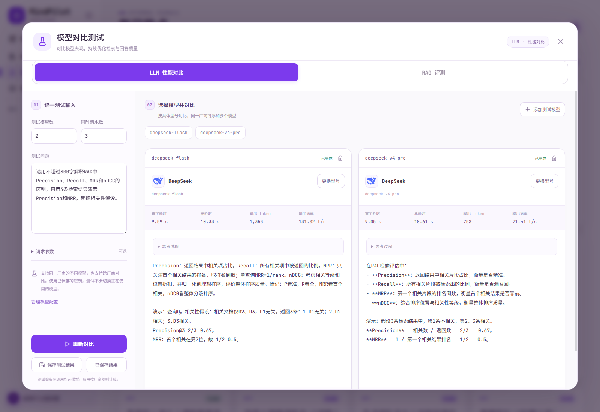

*截图为此前实际调用 `deepseek-flash` 与 `deepseek-v4-pro` 保存的单题结果。耗时受提示词、网络、输出长度及厂商服务状态影响，不能据此推断所有任务的模型优劣。*

### 9. RAG 评测：先检查检索，再检查生成依据

RAG 实验室提供与正式资料库隔离的测试空间，按 **测试集与黄金标注 → 对比方案 → 结果与相关性复核** 三步使用。

可以组合不同 Embedding、Reranker、分块大小与 Top-K，比较检索结果，并结合黄金答案和原文证据检查生成质量。

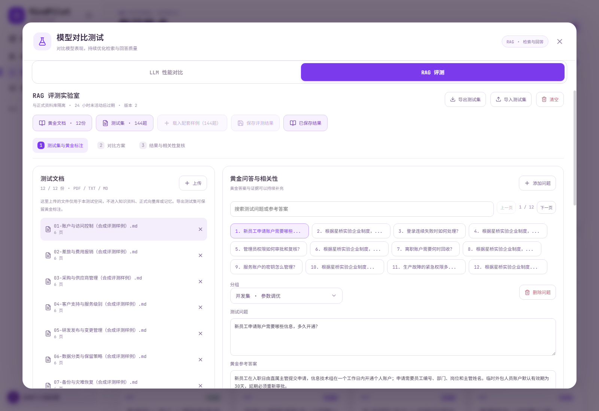

**检索质量指标**

| 指标 | 观察什么 |
| :--- | :--- |
| **Recall@K** | 黄金相关文档被召回的比例，检查遗漏 |
| **文档 Precision@K** | 前 K 个文档中相关文档的比例 |
| **片段 Precision@K** | 命中片段中相关片段的比例，与文档口径分别展示 |
| **MRR@K** | 首个相关结果的排名倒数，检查最先出现的有效结果 |
| **nDCG@K** | 按相关性等级与排名折扣衡量排序质量 |
| **Hit Rate@K** | 至少命中一个相关结果的问题比例 |
| **标注覆盖 / 证据覆盖** | 评分是否有充分标注与黄金证据支持 |

**生成一致性指标**

| 指标 | 观察什么 |
| :--- | :--- |
| **Faithfulness · 事实支持** | 回答中的事实是否由检索材料支持 |
| **语义忠实度 · 余弦** | 回答与材料的 Embedding 相似度，单独展示，不等同于事实正确性 |
| **Groundedness · 双信号** | 逐句检查语义相似度或字面依据，减少短答案被误判 |
| **Factual Consistency** | 通过评判模型检查事实与上下文的一致性 |
| **潜在幻觉率** | 根据依据不足的句子比例提供风险线索 |
| **参考一致性 / 参考事实召回** | 与黄金参考答案对比，检查关键事实覆盖情况 |

页面提供优秀 / 良好 / 需优化参考区间和指标口径说明。未完成或缺少评判条件的指标不会用虚构分数补齐。

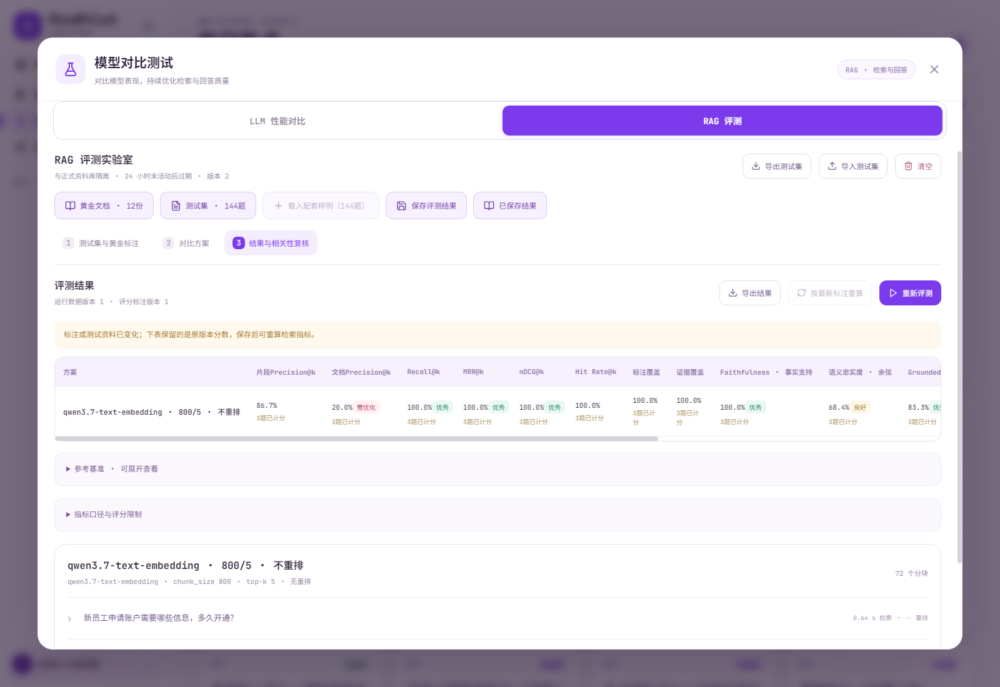

**保留与复核**：点击“保存评测结果”长期保存报告；从“已保存结果”恢复查看或下载 JSON。标注变化后可重算检索指标，旧报告会保留原数据版本与评分版本信息。

*截图恢复的是本机已有的三题生成评测报告，来自合成语料中的小样本；不是完整 144 题测试成绩。页面中的高分不代表真实业务或任意资料库都达到同样效果。测试空间在 24 小时未活动后过期，重要测试集和结果应分别导出或保存。*

### 10. 黄金文档与测试集：可视化管理和编辑

**黄金文档**有独立入口。可以按文档和页查看正文、修改名称与内容、保存或删除。正文变更后，旧证据位置会清除并标记待复核，避免用已失效的位置评分。

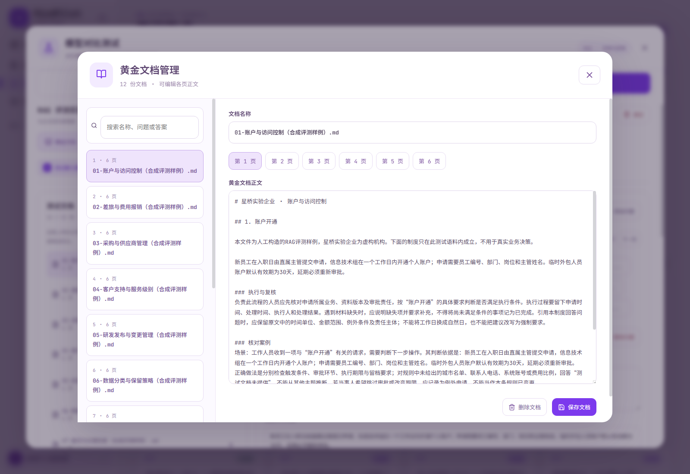

**测试集**也有独立入口。可以维护问题、参考答案、开发集 / 测试集分组、文档相关等级和黄金证据，用于可重复评测。

项目提供 **12 份黄金文档、72 页、144 条问题**的配套合成样例，便于熟悉标注和评测流程。样例中的“星桥实验企业”是虚构机构，制度仅在测试语料内成立；正式评测应换成你的实际资料与复核过的标注。

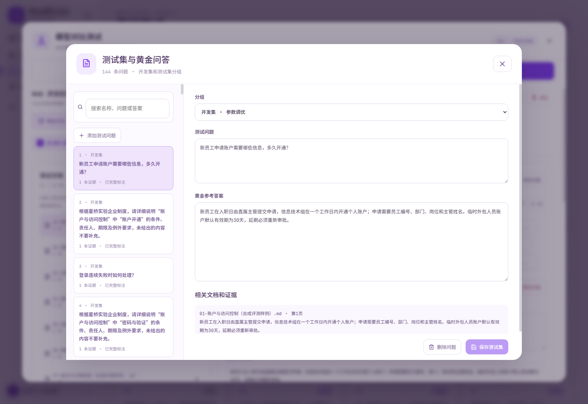

### 11. 会话地图：把对话组织成工作空间

会话地图管理的是**对话之间的关系**，与“知识可视化”中的资料图谱分开。可以创建工作区、整理会话卡片、连接思路，并从卡片进入对应对话继续工作。

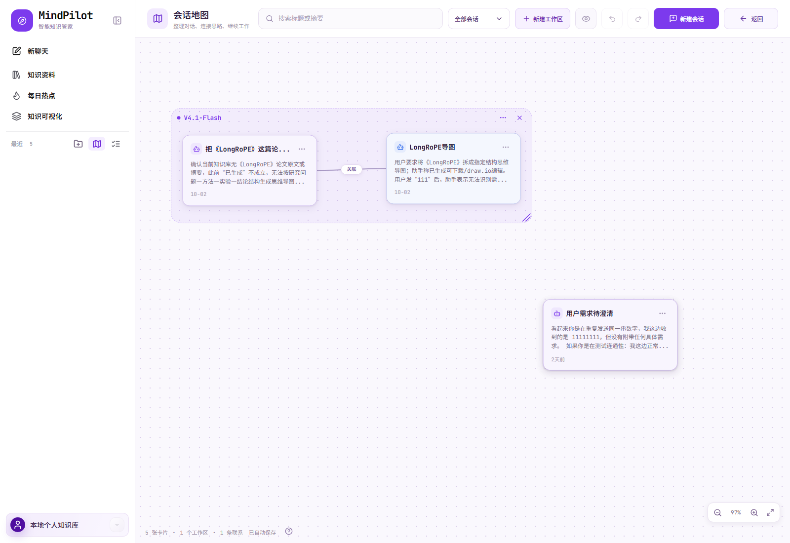

本次创建的“向量检索助知识库”对话会保留在本地账号中。截图中的其他会话是本机已有记录，不随公开源码仓库分发。

### 12. 可编辑产物：把问答变成流程图与结构图

输入 `/` 可以打开能力选择面板，选择知识问答、论文对比、概念追溯、技术调研、Wiki 整理，或流程图、思维导图、海报设计入口。

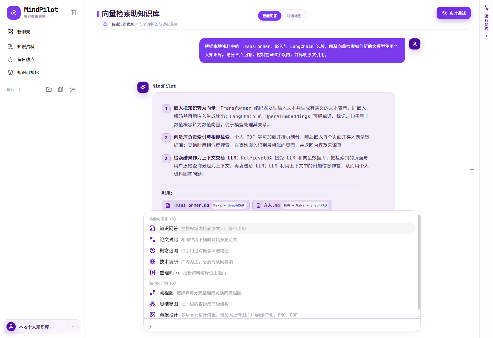

本次把书籍选段中的知识库问答步骤实际生成了流程图。图卡可以预览、下载，并在当前页面打开本地集成的 draw.io 编辑器。

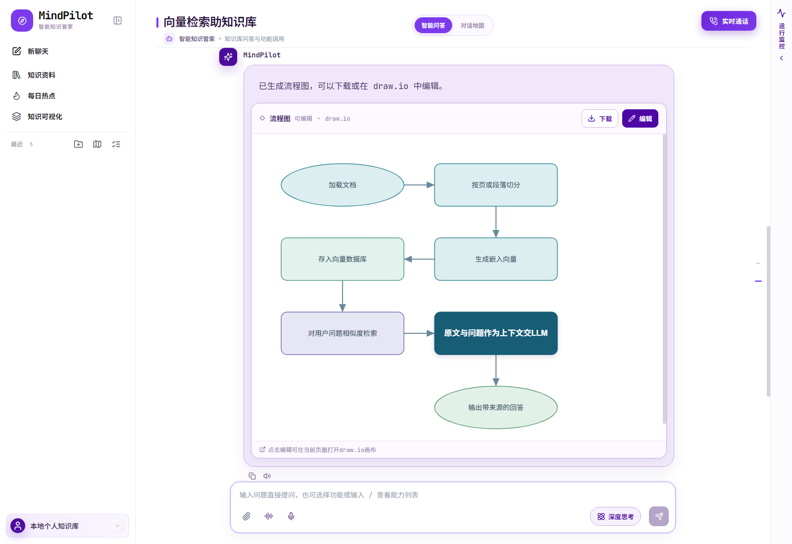

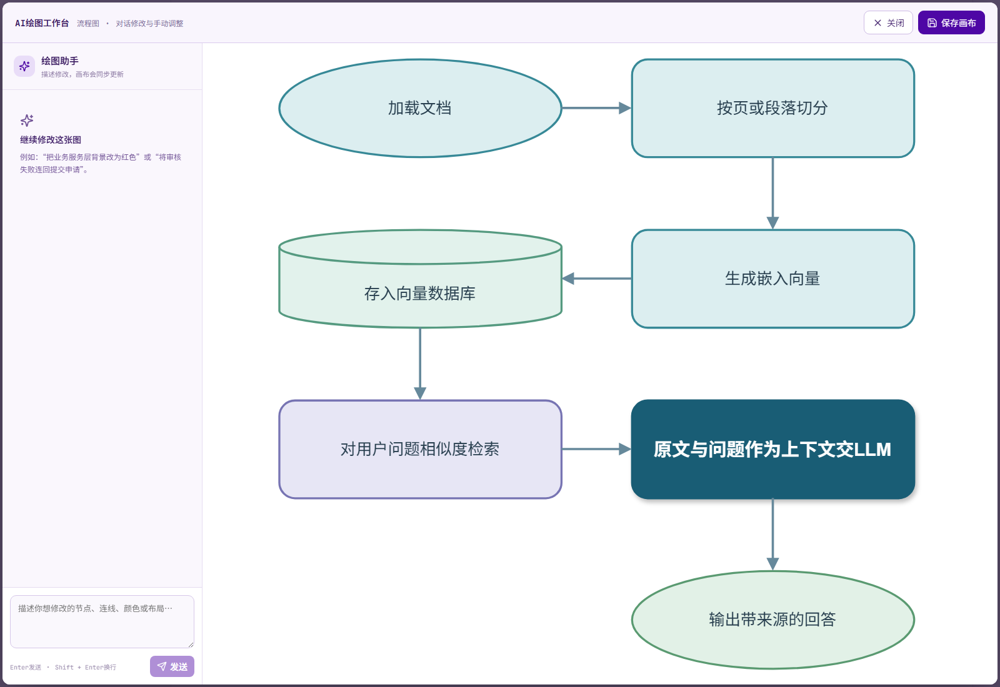

海报设计入口提供设计、渲染与质检流程，可结合上传图片生成 HTML 产物并导出 PNG / PDF；本次文档展示其真实入口，没有额外执行海报生成。图像与海报能力需要相应模型或运行依赖。

### 13. 语音交互（文字介绍）

MindPilot 提供语音输入、实时通话入口与回答朗读，模型配置中的 ASR 和 TTS 分别用于识别和合成。

- ASR / TTS 可按类别获取模型列表，使用配置的对应接口与密钥。
- TTS 音色列表与所选模型关联，可搜索音色名称或 ID，并在支持的接口上试听、暂停。
- 音色选择、模型配置与日常文本模型分别管理；厂商原生语音协议与兼容文本协议不能混用。
- 实时录音需要浏览器麦克风权限，以及可用的模型、音色和对应厂商协议支持。

按照本次演示范围，**没有进行录音、实时通话或音色试听实操**，此处仅介绍功能。

## 工作原理

### 三层知识结构

| 层次 | 保存什么 | 在系统中的职责 |
| :--- | :--- | :--- |
| **Raw Sources · 原始层** | 原始文件、解析文本、可引用分块、来源指纹 | 事实基准，RAG 精确定位原文 |
| **Wiki Layer · 编译层** | 带来源编号的 Markdown、关键知识与 `[[wikilink]]` | 提炼、组织和连接已有资料 |
| **Schema Layer · 规则层** | Wiki 编译规则、结构和质量约束 | 约束生成，保留来源、条件与不确定性 |

“原始层”是逻辑分层，实际上传文件保存在 `backend/data/documents/`，并非要求用户自行创建一个 `raw/` 文件夹。

### 三路检索如何融合？

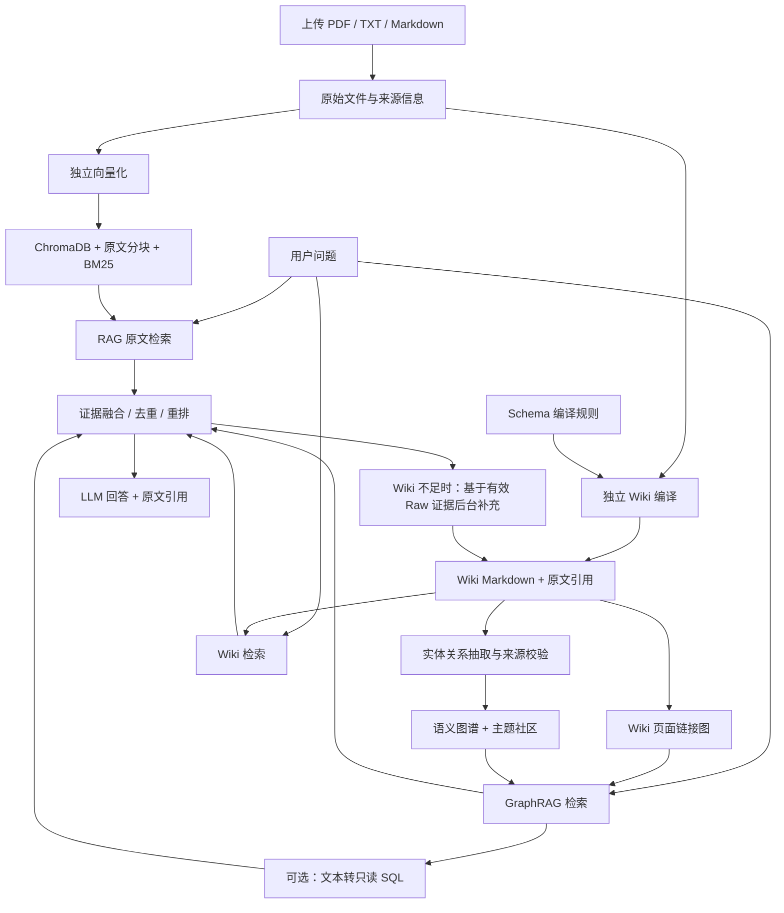

- **RAG**解决“具体原文在哪里”，当前使用 **ChromaDB 向量检索 + BM25 + 排名融合**；可用的 Reranker 进一步调整候选顺序。
- **Wiki**解决“资料已经整理成什么知识”，即使未向量化，也能从有效编译结果及其原文引用召回内容。
- **GraphRAG**解决“这些知识如何关联”，通过页面链接、语义关系与社区摘要扩展相关资料，限制跳数与候选数量。
- **融合层**把多路召回统一为证据，保留来源标记，并在回答后调度基于原文的 Wiki 补充；模型回答本身不会被当作新事实来源。

各路检索可能降级，三类来源标签只表示本轮实际命中的途径。图谱 SQL 只在隔离的图快照上执行；最终答案仍需能追溯到有效原始资料。

## 快速开始

### 环境与依赖

本次本地实操环境为 **Windows、Python 3.13.5、Node.js 22.20.0**。使用 Python 虚拟环境安装后端依赖，使用 npm 安装前端依赖。

默认采用 SQLite 和 ChromaDB 本地存储，不需要先启动独立数据库服务。问答、编译、图谱抽取和远程向量化需要你自己的模型配置；联网热点还需要搜索服务配置。

### 1. 启动后端

在项目根目录打开终端：

```powershell
cd backend
python -m venv .venv
.venv\Scripts\Activate.ps1
python -m pip install -r requirements.txt
python -m uvicorn app.main:app --host 127.0.0.1 --port 8000 --reload
```

PowerShell 不允许激活脚本时，可以直接使用虚拟环境内的 Python：

```powershell
.venv\Scripts\python.exe -m pip install -r requirements.txt
.venv\Scripts\python.exe -m uvicorn app.main:app --host 127.0.0.1 --port 8000 --reload
```

健康检查：`http://127.0.0.1:8000/health`；API 文档：`http://127.0.0.1:8000/docs`。

### 2. 启动前端

在项目根目录打开另一个终端：

```powershell
cd frontend
npm ci
npm run dev
```

浏览器打开终端显示的 Vite 地址，通常是 `http://localhost:5173`。前端默认将 `/api` 请求代理到本地 `8000` 端口。

### 3. 首次使用

1. **注册自己的账号**：公开仓库不包含本机账号和登录状态。
2. **配置模型**：个人中心 → 模型配置，填写自己的接口、密钥、模型名称，保存后启用对应类别。
3. **导入资料**：知识资料 → 导入资料，选择 PDF、TXT 或 Markdown 与知识域。
4. **选择处理方式**：需要原文向量检索就向量化，需要结构化整理就 Wiki 编译；可以分别执行。
5. **构建图谱**：已有 Wiki 后，在知识可视化页面点击“构建 / 更新图谱”。
6. **开始提问**：查看答案、引用与来源标记，必要时打开原文核对。
7. **评测与复用**：通过模型对比和 RAG 实验室检查方案，把有价值的结果保存下来。

### 4. 构建与开发检查

```powershell
# 在 frontend 目录
npm run build
```

```powershell
# 在 backend 目录，使用已配置的 Python 虚拟环境
python -m pip install -r requirements-dev.txt
python -m pytest -q
```

前端构建生成 `frontend/dist/`。构建成功不等于自动部署；默认开发服务器配置也不等于面向公网的部署配置。

## 本地数据与模型调用

| 位置 | 内容 | 是否包含在公开源码副本中 |
| :--- | :--- | :--- |
| `backend/data/` | 账号数据库、原始资料、向量索引、Wiki、图谱与评测报告等业务数据 | 否，运行时创建 |
| `.mindpoilt/` | 模型配置、会话状态、事件记录、上下文、记忆与编译规则等 | 否，运行时创建 |
| `docs/images/` | 本 README 使用的已检查截图 | 是 |
| `frontend/vendor/drawio/` | 本地集成的第三方编辑器源码与许可文件 | 是 |

数据文件保存在本地，**不意味着模型处理完全离线**：使用远程 LLM、Embedding、Reranker、语音或联网搜索时，所需的问题、片段、音频或搜索关键词会发送给相应服务商。自行配置兼容本地服务时，可用能力取决于该服务支持的接口。

此源码副本不带 `artifacts/`、个人数据库、原始 PDF、模型密钥、登录凭证和完整会话记录。README 截图使用了本机实际数据，接口地址与密钥保持遮挡，账号显示名已隐藏；公开截图仍会展示你在图中看到的文档标题、短选段和部分会话内容。

不要将运行后的 `.mindpoilt/`、`backend/data/` 或个人 `.env` 强制加入 Git。需要备份个人实例时，应单独保护这些运行数据。

## 截图与实操记录

本页图片来自 **2026-10-12 的本地浏览器实操**，不是设计稿或填充的效果图。公开源码首次启动不会自带这些资料和结果。

| 实操部分 | 实际执行内容 |
| :--- | :--- |
| 资料准备 | 从本机已有 202 页 PDF《大模型应用开发极简入门：基于 GPT-4 和 ChatGPT》（2024）提取第 39–40、170、178–180 页中的相关选段，按 Transformer、嵌入、LangChain 整理成三个 Markdown 文件。 |
| 导入与索引 | 在资料导入界面实际选择并上传三份文件；“嵌入”完成向量化，生成两个分块。 |
| Wiki | 三份选段实际调用已配置模型编译，保留 `[S编号]` 引用与 `[[wikilink]]`。 |
| 图谱 | 执行项目实际的关系抽取、原文校验和社区整理流程，得到 61 个实体、62 条关系、11 个社区；实际运行 Transformer 关系查询并查看来源。 |
| 问答与产物 | 实际发出知识库问题，得到带三路来源标签的回答与追问卡片；随后生成流程图并打开 draw.io 编辑器。 |
| 模型配置 | 实际获取阿里云 Embedding 模型列表，输入 `qwen` 模糊筛选；没有更改已启用型号。 |
| 热点 | 打开本机已有热点列表和详情，没有为截图重新执行长时间新闻同步。 |
| 评测 | 在真实界面打开已保存的 DeepSeek 两型号对比与三题 RAG 生成评测报告，并打开黄金文档和 144 题测试集管理页；没有将历史结果伪装为本次新跑的测试。 |
| 语音 | 仅文字介绍，没有录音、通话或试听。 |

选段只是为控制实操规模而整理的本地资料，不随源码分发；其中的跨资料阅读导航是人工添加的导航，已在原文中注明不属于原书事实。PDF 页码指文件页码，选段上传后的 Markdown 页码另行计算。

## 项目结构

```text
MindPilot/
├── backend/
│   ├── app/
│   │   ├── agents/          # 问答、调度与检查工作流
│   │   ├── api/             # 账号、资料、会话、模型、评测与图谱接口
│   │   ├── core/            # 配置、安全与本地存储布局
│   │   ├── db/              # SQLite 模型与数据库管理
│   │   ├── services/        # 文档处理、Wiki、图谱、模型与评测服务
│   │   └── tools/           # 知识检索、联网搜索等工具
│   ├── tests/
│   └── requirements.txt
├── frontend/
│   ├── src/
│   │   ├── api/             # 后端请求与流式接口
│   │   ├── components/      # 问答、配置、评测、图谱与编辑器组件
│   │   ├── stores/          # 会话、账号与界面状态
│   │   └── views/           # 资料、聊天、地图与知识可视化页面
│   └── vendor/drawio/       # 第三方 draw.io 编辑器
├── docs/images/             # 实际操作截图
├── GRAPH_RAG_DESIGN.md
├── WIKI_THREE_LAYER_DESIGN.md
├── RAG_EVALUATION_DESIGN.md
├── SESSION_MEMORY_DESIGN.md
└── README.md
```

---

## 让知识持续生长

我们希望 MindPilot 能成为你日常学习与探索中的长期伙伴：让每一份读过的资料都有迹可循，让每一次提问都能连接已有知识，让零散的想法逐渐沉淀为属于自己的知识网络。

项目仍在持续完善。欢迎分享使用体验、提出功能建议，或通过 Issue 和 Pull Request 参与改进。如果 MindPilot 对你有所帮助，也欢迎点亮一颗 Star，支持项目继续成长。

感谢每一位使用者与贡献者，也感谢为本项目提供基础能力的开源社区。

**从一份资料开始，让每一次探索都有积累。**


