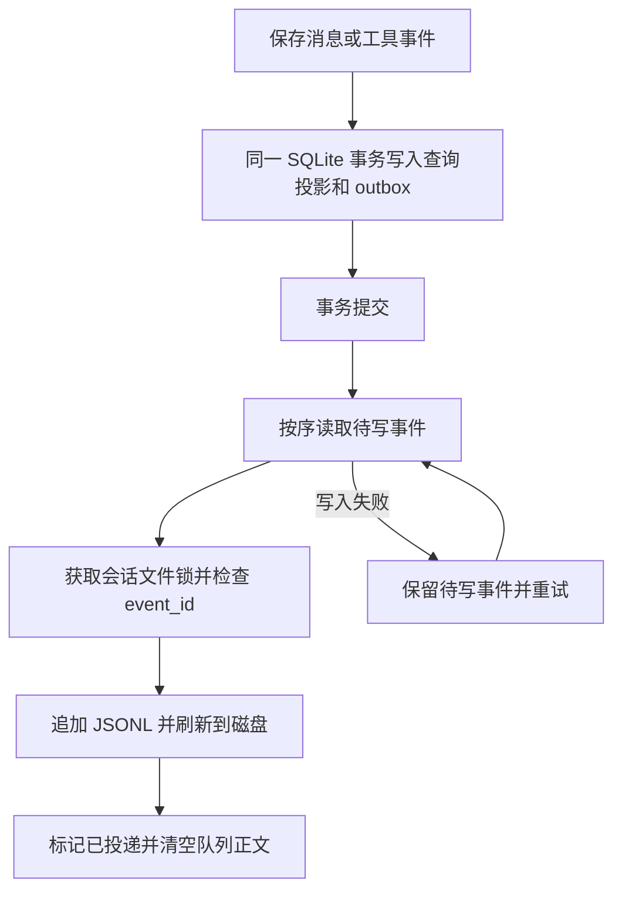

# 会话、记忆与配置的本地存储设计：业务数据隔离方案

更新日期：2026-10-10。适用场景：具有用户登录、聊天、工具调用、知识资料和模型配置能力的本地 Agent 应用。

本文按 MindPilot 当前实现重新整理，供其他项目复用。核心方案是：**业务数据放在 `backend/data/`，会话、上下文、记忆及模型配置放在根目录 `.mindpoilt/`；两类数据分别使用自己的数据库和文件目录。**

文中的“当前实现”对应本项目现有代码；“建议”或“预留”对应移植及后续扩展。目录名沿用项目约定的 `.mindpoilt`，业务数据库名为 `mindpoilt.sqlite`，可在其他项目中统一替换为应用名称。

## 1. 设计目标与基本约定

这套设计同时解决四类问题：

1. 保留完整会话和工具过程，能够恢复历史、排查问题、重新生成摘要。
2. 在模型上下文有限时压缩旧历史，同时保留最近十轮完整对话。
3. 从历史工作中提取有来源、可复用的长期记忆，供新会话按需参考。
4. 将账号、文件和业务产物与 Agent 的上下文、记忆和模型凭证分开管理。

关键约定：

- 压缩改变发送给模型的上下文，不删除原始会话记录。
- 同一会话的原始消息、工具事件和多版压缩摘要放在同一个 JSONL 文件中。
- 短期记忆是一次模型请求的上下文构建结果，不单独维护 `short_memory.md`。
- 长期记忆是提炼结果，不是聊天全文备份，也不是全部知识资料的副本。
- SQLite 不只保存文件路径，还保存查询投影、任务状态、权限关联和恢复检查点。
- 身份引用允许跨存储边界，例如会话保存 `user_id`；账号密码哈希、登录令牌哈希和个人资料由业务库管理。
- 当前采用的是目录、数据库和职责隔离；后端仍能访问两套数据，不等于独立进程或操作系统权限隔离。

## 2. 先确定数据归属

分类依据是数据承担的职责，而不是它是否由模型产生。

| 数据类型 | 保存位置 | 说明 |
| --- | --- | --- |
| 用户账号、密码哈希、个人资料、头像 | 业务数据库 | 应用账户管理 |
| 登录会话、刷新令牌哈希、登录失败与锁定 | 业务数据库 | 用户认证及撤销状态 |
| JWT 签名密钥 | `backend/data/.jwt_secret` | 属于登录系统，与模型 API Key 分开 |
| 上传资料、聊天上传文件及预览 | `backend/data/` | 原文件与文件索引由业务层管理 |
| 文档分块、资料向量索引、Wiki 等业务知识 | 业务数据库及 `backend/data/chroma/` | 属于知识资料功能，不直接等同于长期记忆 |
| 工具生成的文件、生成图片 | `backend/data/` | 可下载的业务产物 |
| ASR/TTS 音频缓存、模型对比结果及产物 | `backend/data/` | 语音缓存预留；RAG 临时测试集与报告已进入业务库，测试文件放入独立子目录 |
| 会话原始消息、工具输入输出、执行轨迹 | `.mindpoilt/sessions/` | JSONL 会话事件日志 |
| 本轮模型上下文记录、压缩摘要 | 同一会话 JSONL | 使用事件类型区分 |
| 会话标题、消息投影、任务与事件投递状态 | Agent 状态数据库 | 用于查询和执行恢复 |
| 长期记忆 Markdown、来源摘要及整合检查点 | `.mindpoilt/memories/` 与 Agent 状态数据库 | 用户隔离、可溯源 |
| 上下文窗口、压缩阈值、记忆生成策略 | `.mindpoilt/config.toml` | Agent 行为配置 |
| 模型接口、模型参数、厂商 API Key、工具服务凭证 | `.mindpoilt/models.json` | 经配置安全层受控读写 |

两组容易混淆的边界：

- **工具事件与工具产物**：调用参数、结果、执行状态放入会话日志或状态库；生成的 PDF、图片、Draw.io 文件及其下载索引放入业务目录和业务库。
- **上传知识与长期记忆**：上传资料可以完整保留并向量化；长期记忆只提取有证据的偏好、项目知识和经验，不把每份资料复制到 `MEMORY.md`。

例如，用户上传 PDF 后询问内容：PDF 原件、分块和向量属于业务数据；提问、助手回复、检索工具事件属于会话数据；以后提炼出的已验证工作方法属于长期记忆。

## 3. 推荐目录与当前实现

```text
MindPilot/
├── SESSION_MEMORY_DESIGN.md
├── .mindpoilt/                              # Agent 状态与模型配置
│   ├── README.md
│   ├── config.toml                          # 上下文与记忆策略
│   ├── models.json                          # 模型参数、厂商及工具凭证
│   ├── state_1.sqlite                       # Agent 查询投影与恢复状态
│   ├── session_index.jsonl                  # 可重建的会话目录
│   ├── sessions/YYYY/MM/DD/
│   │   └── rollout-YYYY-MM-DDTHH-MM-SS-<会话ID>.jsonl
│   ├── archived_sessions/                   # 预留，当前没有归档 API/UI
│   ├── memories/<用户ID>/
│   │   ├── memory_summary.md
│   │   ├── MEMORY.md
│   │   ├── raw_memories.md
│   │   ├── projects/<范围哈希>.md
│   │   └── rollout_summaries/<会话ID>.md
│   ├── thread-writer-locks/                 # 状态文件多进程写锁
│   ├── tmp/                                # Agent 状态临时文件
│   └── backups/                            # 仅 Agent 状态及配置的备份
├── backend/
│   ├── .env                                # 原文件保留，模型不再从中读取配置
│   ├── app/
│   └── data/                               # 应用业务数据
│       ├── mindpoilt.sqlite                 # 账号、登录、资料及文件业务索引
│       ├── .jwt_secret                      # 登录签名密钥
│       ├── documents/<用户ID>/              # 上传资料原件
│       ├── chat_previews/<用户ID>/           # 聊天上传与预览文件
│       ├── agent_artifacts/<用户ID>/         # 工具生成文件
│       ├── generated_images/<用户ID>/        # 生成图片
│       ├── chroma/                          # 资料向量索引
│       ├── speech_cache/
│       │   ├── asr/                         # 识别缓存目录，预留
│       │   └── tts/                         # 合成缓存目录，预留
│       ├── model_comparisons/rag/<空间ID>/   # 独立、可过期的 RAG 测试文档
│       └── backups/                         # 业务库与历史混合库备份
└── frontend/
```

目录规则：

- 会话文件路径由创建时间的 UTC 日期和稳定会话 ID 决定，跨天继续写原文件，不以可变标题命名。
- 会话日志按日期排列，所属用户与真实路径由数据库映射校验；用户不能直接提供任意文件路径。
- 长期记忆按用户分目录，业务文件也按用户组织或通过数据库检查归属。
- `state_1.sqlite` 的数字是本项目的文件命名约定，不代表与 Codex 某个内部数据库版本对应。
- 状态临时文件进入 `.mindpoilt/tmp/`；业务缓存、上传临时文件或对比产物不要因为由 Agent 产生就进入状态目录。
- 真实密钥、数据库、聊天、记忆和上传文件都是私有运行数据，不应包含在公开源码分发中。

当前语音采用流式处理，音频缓存尚未持久化。LLM 对比结果留在当前界面；RAG 临时语料、黄金问答和最近三份完成报告进入业务库 `evaluation_workspaces`，文件位于 `model_comparisons/rag/<空间ID>/`，24 小时未写入后过期。程序启动或打开测试空间时清理过期记录。测试集可导出并重新导入，不进入正式资料库、会话日志或记忆。详见 [RAG 评测设计](backend/RAG_EVALUATION.md)。

## 4. 两个 SQLite 数据库分别保存什么

### 4.1 业务数据库：`backend/data/mindpoilt.sqlite`

| 表 | 职责 |
| --- | --- |
| `users` | 用户 ID、用户名、头像、个人资料、Argon2 密码哈希 |
| `auth_sessions` | 登录会话、刷新令牌哈希、有效期、记住登录及撤销状态 |
| `login_attempts` | 登录失败次数与临时锁定 |
| `documents` | 上传文件元数据、路径、状态与向量化进度 |
| `document_chunks` | 文档分块与向量关联 |
| `agent_artifacts` | 工具文件的元数据、下载路径与关联任务 ID |
| `generated_images` | 生成图片业务记录 |
| `workbench_entries` | Wiki、每日热点标题/摘要/整理正文、多来源链接与引文证据、查看状态，以及账户独立的热点偏好（内部 `hot-preferences` 分类） |
| `evaluation_workspaces` | 用户隔离的 RAG 临时语料、黄金问答、相关性、版本与报告 |
| `alembic_version` | 当前迁移链版本，负责两库的表结构升级 |

未来音频缓存与长期保存的模型对比历史也属于这个数据库。当前 RAG 空间为临时数据，不能将其等同于永久评测档案。

### 4.2 Agent 状态数据库：`.mindpoilt/state_1.sqlite`

| 表 | 职责 |
| --- | --- |
| `conversations` | 会话标题、所属用户、创建/更新时间、任务分组 |
| `messages` | 消息查询投影，支持搜索、统计与来源检查 |
| `conversation_maps`、`conversation_inheritance` | 会话组织及继承背景 |
| `agent_runs` | 执行轨迹投影 |
| `agent_tasks`、`agent_task_events` | 工具任务、父子任务及执行事件 |
| `conversation_title_jobs` | 首轮标题生成状态 |
| `conversation_journals` | 会话到 JSONL 的路径映射与导入检查点 |
| `session_events` | 待写 JSONL 的事务 outbox 及投递检查点 |
| `memory_extractions` | 单会话记忆提取版本、结果、任务与重试状态 |
| `memory_documents` | 用户级记忆整合结果及 Markdown 重建检查点 |
| `model_configurations` | 保留的旧模型配置元数据表；不是当前配置来源 |

模型参数与密钥的实际来源是 `models.json`。不能让文件、旧配置表和 `.env` 同时成为竞争的配置来源。

### 4.3 原始记录、查询投影和检查点

三者职责不同：

- **JSONL** 保存会话原始事件及所有摘要版本，聊天恢复和上下文构建通过重放获得有效历史。
- **状态库** 保存可查询的消息内容和运行状态，让列表、统计、搜索、权限校验及可靠投递不必每次扫描所有文件。
- **Markdown** 保存可阅读、可选择性引用的长期记忆；状态库保留提取及整合结果，支持原子更新失败后的恢复。

`session_events` 成功投递后清空正文，保留事件 ID 和投递检查点，不作为另一套永久完整日志。

部分索引和文件可以根据已有记录重新生成，但**任何一个完整数据库都不能承诺仅凭 JSONL 无损恢复**。业务库中的密码哈希和登录状态、状态库中的任务与恢复信息，都需要数据库备份。

## 5. 跨库访问、事务与关联完整性

### 5.1 当前采用同一连接挂载两库

每个 SQLite 连接以业务库作为 `main`，通过 `ATTACH` 将状态库挂载为 `agent_state`。ORM 为状态表声明对应 schema：

```sql
-- 路径示意，实际代码使用绑定参数。
ATTACH DATABASE '<项目根目录>/.mindpoilt/state_1.sqlite' AS agent_state;

SELECT id, username FROM main.users;
SELECT id, title, user_id FROM agent_state.conversations;
```

这样既保留独立数据库文件，又能使用现有 SQLAlchemy Session 查询两库，并在同一 SQLite 事务中提交关联更新。

当前两个磁盘数据库均使用 **DELETE 回滚日志**，不启用 WAL。SQLite 的跨挂载数据库原子提交依赖相应前提，移植时应保持磁盘主库及这种日志模式。不能仅因为使用了 `ATTACH`，就假设内存主库或 WAL 模式也具备相同跨文件原子性。

这和“创建两个独立 engine，分别 commit”是不同方案。若以后改成独立连接或不同数据库服务，必须重新设计跨库一致性、补偿及事件投递，不能继续沿用单事务承诺。

### 5.2 外键与删除规则

SQLite 支持库内外键，不支持跨 `ATTACH` 数据库声明外键。

- 同库关联继续使用 SQLite 外键，例如用户与登录会话、会话与消息、任务与任务事件。
- 跨库 ORM 关联在提交前由 `storage_integrity.py` 检查，例如会话引用业务库用户、业务产物引用状态库任务。
- 删除会话或任务时，通过应用逻辑清理业务库中的关联工具产物元数据。
- 文件实体删除与数据库记录删除不是同一回事；当前关联清理不能描述成自动彻底删除所有产物文件和备份。

直接使用 SQLite 客户端或绕过 ORM 的批量 SQL，不会自动获得上述跨库校验。新业务操作需要通过统一服务层执行，并为跨库引用补充检查。

### 5.3 用户与项目边界

每次 API 请求先确认登录会话和用户，再查询该用户所属会话、记忆及文件。日志中保留 `user_id` 用于身份关联，不将账号密码哈希或登录令牌复制进会话文件。

多项目应用还应区分用户权限与项目范围。当前长期记忆使用 `Conversation.task_id` 作为分组范围，不能等同于完整的独立项目权限系统。

## 6. JSONL 会话事件设计

### 6.1 事件信封

UTF-8 编码，每行一个独立 JSON 对象。当前事件信封如下：

```json
{
  "seq": 1,
  "event_id": "event-example-001",
  "timestamp": "2026-10-10T08:00:00Z",
  "type": "session_meta",
  "payload": {
    "conversation_id": "conversation-example",
    "user_id": "user-example"
  }
}
```

`event_id` 是幂等投递标识；`seq` 是当前日志中的事件序号，不是对话轮数，也不是摘要版本号。其他项目建议在会话元数据中增加明确的格式版本，并定义新增事件的兼容规则。

### 6.2 主要事件

| 类型 | 保存内容 | 展示方式 |
| --- | --- | --- |
| `session_meta` | 会话元数据 | 不作为聊天气泡 |
| `response_item` | 消息及其更新版本 | 重放后的有效消息 |
| `tool_call`、`tool_result` | 工具请求和结果 | 按产品需要展示过程 |
| `run_trace`、`task_event` | 执行轨迹和任务事件 | 不直接当作助手回复 |
| `inherited_context` | 继承的会话背景 | 不伪装成用户新提问 |
| `turn_context` | 本次输入背景、历史引用与 token 预算 | 不作为聊天气泡 |
| `compacted` | 压缩摘要、窗口、覆盖范围和来源版本 | 不作为聊天气泡 |
| `message_deleted` | 单条消息删除标记 | 重放时移除对应消息 |

消息修改采用相同消息 ID 的新事件，重放时最新版本生效。单条删除追加删除标记，原始字节仍可能留在日志中；如需要彻底擦除，必须另行设计日志重写和备份保留策略。

删除整个会话通过 outbox 删除任务清理对应日志，避免旧待写事件重新创建已经删除的会话文件。

### 6.3 同一个文件里的消息与摘要

以下每行可独立解析，名称及内容均为示例：

```jsonl
{"seq":1,"event_id":"evt-1","timestamp":"2026-10-10T08:00:00Z","type":"session_meta","payload":{"conversation_id":"chat-1","user_id":"user-1"}}
{"seq":2,"event_id":"evt-2","timestamp":"2026-10-10T08:01:00Z","type":"response_item","payload":{"type":"message","message":{"id":"msg-u-1","role":"user","content":"检查数据隔离设计","metadata":{},"created_at":"2026-10-10T08:01:00Z"}}}
{"seq":3,"event_id":"evt-3","timestamp":"2026-10-10T08:01:10Z","type":"response_item","payload":{"type":"message","message":{"id":"msg-a-1","role":"assistant","content":"账号使用业务库，会话使用状态库。","metadata":{},"created_at":"2026-10-10T08:01:10Z"}}}
```

达到压缩条件后，继续向同一个文件追加 `compacted` 事件，不覆盖前面的原始消息，也不另建每轮短期记忆文件。

## 7. SQLite 与 JSONL 的可靠写入

SQL 事务和普通文件追加不能直接组成一个原子事务。当前采用事务 outbox：



| 故障 | 恢复行为 |
| --- | --- |
| SQL 提交前失败 | 查询投影和待写事件一起回滚 |
| SQL 已提交，JSONL 未写成功 | 待写事件保留，读取、启动或后台扫描时重试 |
| JSONL 已写，投递标记未提交 | 使用同一 `event_id` 重试，防止重复追加 |
| 文件最后一行未写完整 | 在受控写入时修复不完整尾部，保留已有完整记录 |
| 文件中间记录损坏 | 显式报错，不静默忽略 |
| 删除任务与历史待写事件同时存在 | 优先处理删除，不重建孤立会话文件 |

进程内锁和操作系统文件锁防止多个进程同时追加同一会话。索引、配置与 Markdown 的整文件更新使用临时文件和原子替换。

这里的一致性保证分两层：**两个 SQLite 文件中的事务保持一致；SQLite 与 JSONL 之间通过可重试投递恢复到一致状态。** 不能将后者描述成文件与数据库始终同步提交。

## 8. 短期记忆：完整历史与最近十轮

### 8.1 一轮的定义

一轮从一次用户提问开始，包含后续助手回复和关联工具过程，直到下一次用户提问。

因此“最近十轮”按用户消息的起点切分，不等于最后十条消息，也不固定等于二十条消息。当前新问题单独追加，通常请求中包含十个历史用户轮次，再加当前问题。

### 8.2 历史较少时

没有达到压缩阈值，且整个输入预算允许时，使用完整有效历史：

```text
模型输入 = 系统指令 + 当前任务或检索背景 + 按需长期记忆
         + 完整有效会话历史 + 当前问题
```

不能从第一轮起就固定只读最后十轮，然后把更早内容直接丢掉。

### 8.3 达到压缩阈值后

压缩十轮尾部之前的历史，保留完整尾部：

```text
模型输入 = 系统指令 + 当前任务或检索背景 + 按需长期记忆
         + 最新有效累积摘要 + 最近十轮完整历史 + 当前问题
```

摘要保留目标、限制、关键事实、已完成工作、工具结论、失败原因、待办和不确定事项。摘要用于继续任务，不只是概括聊天主题。

### 8.4 多次压缩如何区分

例如已有三十轮历史：

| 请求前的历史 | 累积摘要覆盖 | 保留完整内容 | 摘要关系 |
| --- | --- | --- | --- |
| 第 1—30 轮 | 第 1—20 轮 | 第 21—30 轮 | `S1`，窗口 1 |
| 第 1—31 轮 | 第 1—21 轮 | 第 22—31 轮 | `S2` 引用 `S1`，窗口 2 |
| 第 1—32 轮 | 第 1—22 轮 | 第 23—32 轮 | `S3` 引用 `S2`，窗口 3 |

第 31 轮完成后，不能直接读取 `S1` 加第 22—31 轮，因为第 21 轮会消失。必须先将移出尾部的第 21 轮并入摘要，得到 `S2`。

所有原始消息及 `S1`、`S2`、`S3` 都保存在同一个 JSONL 中。每次请求只使用最新有效的累积摘要，不把所有旧摘要叠加。严格维持十轮尾部可能增加摘要更新调用，移植时应考虑成本，但不能牺牲覆盖连续性。

当前压缩载荷示意如下，消息 ID 数组省略了部分项，仅用于说明字段：

```json
{
  "window_id": "window-2",
  "previous_window_id": "window-1",
  "window_number": 2,
  "summary": "已完成两库隔离，下一步验证恢复流程。",
  "source_revision": "source-content-fingerprint",
  "covered_message_ids": ["message-1", "message-2"],
  "retained_message_ids": ["message-43", "message-44"],
  "replacement_history": [
    {"role": "system", "content": "本会话较早历史的压缩摘要……"}
  ],
  "tokens": {
    "estimated_input": 15000,
    "summary": 600
  }
}
```

其中 `replacement_history` 在实际记录中还包含被保留的历史消息。窗口编号区分版本，覆盖消息 ID 和来源指纹用来验证摘要是否仍适用。

### 8.5 不能只读取最后一条摘要

构建上下文的正确顺序是：

1. 重放消息更新和删除事件，得到当前有效历史。
2. 根据用户轮次计算最近十轮的起点。
3. 从新到旧检查压缩事件，确认覆盖 ID 仍匹配当前前缀，来源指纹未变化。
4. 找出有效摘要尚未覆盖、但已移出十轮尾部的历史，将其并入摘要。
5. 如果旧摘要覆盖到了当前尾部，例如用户从早期位置重新生成回复，则重新计算，避免摘要与完整内容重叠。
6. 组装系统背景、记忆、摘要、尾部和当前问题，核验整个输入预算后记录本轮上下文。

修改、删除或重新生成历史可能使摘要失效。失效摘要作为历史事件保留，但不再用于当前请求。

### 8.6 预算与超限

当前 `config.toml` 的默认策略：

```toml
format_version = 1

[memory]
context_window_tokens = 32000
auto_compact_token_limit = 24000
response_reserve_tokens = 4096
summary_max_tokens = 2000
recent_turns = 10
long_term_memory_enabled = true
memory_min_idle_hours = 6.0
memory_max_age_days = 30
memory_batch_size = 16
memory_poll_seconds = 60
memory_context_tokens = 2000
```

系统指令、检索资料、长期记忆、摘要、完整尾部、工具信息和当前问题都需要计入预算，并为回复预留空间。当前使用 `cl100k_base` 估算；不可用时用 UTF-8 字节数作保守上界，实际厂商计数可能不同。

当没有可压缩的更早历史，或压缩后摘要加十轮完整内容仍超过可用窗口时，明确返回超限错误并保留原记录，不通过静默截断来满足窗口限制。

## 9. 长期记忆：提取、整合、存放与使用

### 9.1 提取内容

| 类别 | 适合保留的内容 |
| --- | --- |
| 用户偏好 | 用户明确表达且有复用价值的语言、格式、交互偏好 |
| 项目知识 | 历史工作中确认的架构、约束、术语和关键结论 |
| 工作经验 | 多次任务可复用的流程与检查方法 |
| 已验证的解决方法 | 有问题、处理过程和结果证据的方法 |

不保留全部聊天、整份上传资料、临时随机数据、未经验证的助手建议或秘密凭证。助手提出的建议不能自动变成“用户偏好”。

### 9.2 当前触发规则

后台默认每六十秒扫描，候选会话需要满足：

- 至少两次用户提问。
- 默认至少空闲六小时，且最后活动在最近三十天内。
- 没有正在排队或运行的相关任务，也没有运行中的轨迹。
- 相同来源版本没有已经完成的提取结果。

单次处理上限默认为十六个候选。失败记录五分钟后的重试时间，来源内容变化后可以重新提取。

当前接口：`GET /api/v1/memories` 查看状态，`POST /api/v1/memories/generate` 请求后台生成。人工触发可跳过空闲等待，仍受开关、来源版本、运行状态等检查约束。

### 9.3 两阶段处理

第一阶段按会话读取有效消息和工具证据，提取摘要与记忆候选，保存到状态库 `memory_extractions`。候选带原始消息 ID 和内容版本；偏好必须有用户消息证据。

第二阶段读取有效候选，去重、合并、保留范围和来源，将整合结果保存到 `memory_documents`，再原子更新用户目录中的 Markdown：

| 文件 | 职责 |
| --- | --- |
| `memory_summary.md` | 简短用户偏好与项目导航 |
| `MEMORY.md` | 整合条目、范围、来源及来源版本 |
| `raw_memories.md` | 第一阶段提取结果，便于检查和整合 |
| `rollout_summaries/<会话ID>.md` | 某次历史工作的摘要及来源版本 |
| `projects/<范围哈希>.md` | 按范围整理的项目知识、经验和解决方法 |

`raw_memories.md` 中的 raw 指尚未跨会话整合的候选，不是原始聊天全文。数据库检查点保留后，即使 Markdown 写入中断，也可以在后续扫描时重新生成文件。

### 9.4 按需使用与来源失效

当前请求从 Markdown 中选择相关内容，在 `memory_context_tokens` 预算内注入；不是每次拼接全部长期记忆。当前检索采用问题关键词匹配、中文片段匹配和偏好加权，没有单独实现长期记忆向量检索。

注入前检查所属用户、来源会话是否存在、来源消息是否存在及其内容版本是否仍一致。来源已删除或修改时，旧条目立即停止注入，不必等待后台完成重新整合。

长期记忆作为历史参考提供给模型，当前用户要求优先；历史材料中的指令不能获得新的系统权限。

当前条目保存范围标签，但检索入口按用户和问题进行选择，并没有严格的当前项目范围过滤。其他多项目应用建议增加明确的 `project_id`，将用户全局偏好与当前项目记忆分开，并在检索入口执行范围过滤，不能仅靠关键词宣称完成项目隔离。

## 10. 模型配置与凭证的安全边界

### 10.1 两类配置各有来源

- `config.toml` 配置 Agent 的上下文和记忆策略。
- `models.json` 配置厂商凭证、接口、模型名称、用途路由及工具服务参数。
- 原 `.env` 保留，但模型运行不再从 `.env` 或旧模型环境变量回退读取。
- `backend/data/.jwt_secret` 属于登录认证，不能为了“密钥集中管理”迁入模型配置。

### 10.2 厂商凭证与用途路由

当前配置采用 `format_version`、`model_routes`、`providers` 和 `integrations`。模型类别包括 `text`、`embedding`、`reranker`、`asr`、`tts`、`image`。

以下是无真实凭证的格式示例，不是可调用模型清单：

```json
{
  "format_version": 1,
  "model_routes": {
    "text": "example_provider",
    "embedding": "example_provider"
  },
  "providers": {
    "example_provider": {
      "display_name": "示例厂商",
      "api_family": "custom",
      "credentials": {
        "api_key": "",
        "speech_key": ""
      },
      "models": {
        "text": {
          "endpoint": "https://model-api.example.com/v1",
          "model_id": "language-model-id",
          "options": {"vision": false}
        },
        "embedding": {
          "endpoint": "https://model-api.example.com/v1",
          "model_id": "embedding-model-id",
          "options": {"dimensions": 1024}
        }
      }
    }
  },
  "integrations": {}
}
```

同一凭证体系下的多个用途共用厂商密钥，不在每个模型项重复保存。不同产品线需要不同凭证时仍应区分，例如当前火山引擎的方舟模型使用 `api_key`，豆包 ASR/TTS 使用 `speech_key`；不能承诺一家厂商的任何 API Key 都可调用所有服务。

保存配置与启用路由是独立动作，每个类别通过路由选择当前模型。模型列表仅在用户点击获取后使用厂商凭证查询，作为本次前端交互的临时选项；没有获取列表时允许手动输入模型名称，不把选项缓存当作正式配置写入文件。

### 10.3 配置调用链

```text
前端模型配置表单
    ↓ 登录与配置权限校验
模型配置 API
    ↓
config.py：结构、路径、接口地址与凭证校验
    ↓ 原子写入 / 受控读取
.mindpoilt/models.json
    ↓ 配置转换与运行时模型选择
model_runtime.py
    ↓
LLM / Embedding / Rerank / ASR / TTS / Image 调用适配器
```

业务调用方不能绕过中间层直接打开配置文件。当前安全层限制文件大小、字段及路由结构，拒绝不安全路径和非法接口地址，使用 `SecretStr` 避免普通对象展示泄露凭证，并以临时文件和原子替换完成保存。

前端默认展示脱敏密钥，不写入浏览器持久化存储；日志和验证错误不输出真实密钥。当前文件保存本身不是加密保险库，仍需本地文件权限保护；其他项目如需更强保护可接入操作系统凭据库。

当前模型配置是项目级共享配置，主账户可修改，其他登录账户查看脱敏结果。需要每用户独立模型凭证的项目，应另行设计权限、配置命名空间与读取路由，不直接复用共享文件规则。

## 11. 用户登录与业务文件管理

本地多账户应用通过业务库管理账号、密码验证和登录撤销。密码保存 Argon2 哈希，刷新令牌保存 SHA-256 哈希，不存原始密码和原始刷新令牌。

当前后端模式的访问令牌保存在浏览器内存，刷新令牌保存在 HttpOnly Cookie。页面刷新后调用刷新接口恢复登录；服务端同时检查 JWT 与对应登录会话。

上传和产物元数据必须包含所属用户、存储路径或受控文件 ID。访问文件时验证用户权限和路径边界，不能只根据文件名存在就返回内容。

业务文件不能随 Agent 状态清理自动消失。例如删除会话，不应顺便删除仍被知识资料、其他任务或未发送草稿引用的上传文件。清理无引用文件需要考虑数据库、日志、草稿、任务和备份，并采用明确的保留策略。

## 12. 归档、删除与压缩是不同操作

| 操作 | 原始内容 | 当前上下文 | 主要目的 |
| --- | --- | --- | --- |
| 压缩 | 保留原始消息及历次摘要 | 使用摘要和完整尾部 | 适应模型上下文窗口 |
| 归档 | 保留会话内容 | 按应用规则恢复或继续 | 整理常用会话列表 |
| 删除 | 按删除与备份规则清理 | 不再使用删除来源 | 移除会话及相关引用 |

当前仅预留 `archived_sessions/`，没有完成归档 API/UI。其他项目实现归档时，建议同时管理归档标志、时间与日志路径，并提供可恢复的文件移动流程。归档不会自动把聊天全文变成长期记忆，也不应默认使有效记忆来源失效。

## 13. 从旧混合数据迁移到隔离布局

### 13.1 迁移对象与原则

当前支持检查旧 `.mindpoilt/state_1.sqlite` 混合库、显式指定的旧业务库，以及初次初始化时的 `backend/data/mindpilot.db`。

保持用户 ID、密码哈希、刷新令牌哈希、文档路径、消息、工具事件及记忆检查点。已存在的 JSONL、Markdown、模型配置、JWT 密钥和 `.env` 无需因数据库拆分而重写。

停止旧版本服务后再启动迁移。新旧目标同时包含数据或出现未分类表时，不自动猜测合并，更不能覆盖任意一方。

### 13.2 可恢复迁移流程

1. 检查路径与迁移锁，恢复上次尚未完成的发布清单。
2. 锁住旧库写入，通过 SQLite backup 在 `backend/data/backups/` 保存完整混合库备份。
3. 在临时副本升级旧结构，再创建两个新的目标数据库。
4. 按表归属复制全部数据，比较行数及所有列值，检查数据库完整性、库内外键和跨库引用。
5. 持久保存迁移清单、暂存路径与文件校验值，再依次替换目标库。
6. 如果两次替换之间中断，下次启动根据清单完成剩余替换，不重复导入。
7. 将状态目录中包含账号或业务表的旧 SQLite 备份迁入业务备份目录。

两个文件的替换本身不是一次原子操作，迁移清单承担中断恢复职责。校验或复制失败时保留原库与备份，不将半成品作为运行库。

### 13.3 其他已有目录的迁移

根目录旧 `mindpoilt/` 可升级为 `.mindpoilt/`；旧模型配置文件 `backend/.mindpoilt` 经验证迁入 `.mindpoilt/models.json`。如果目标配置不同则拒绝覆盖，保护现有密钥。

会话文件迁到按日期组织的路径时，保留原始字节和事件 ID，同步更新状态库路径映射；旧策略 JSON 校验后转换为 TOML，并保存策略备份。

业务文件当前已经使用 `backend/data/`，不再统一迁入隐藏状态目录。其他项目若需要移动上传或产物，必须一起处理元数据路径、向量库、下载服务和草稿引用，不能只移动文件夹。

## 14. 备份、恢复与清理

### 14.1 分区备份与完整恢复

| 备份范围 | 内容 |
| --- | --- |
| Agent 状态 | 状态库、会话 JSONL、长期记忆、策略和模型配置 |
| 业务数据 | 业务库、上传和产物文件、资料向量索引、JWT 密钥 |
| 历史混合库 | 留在 `backend/data/backups/`，按含账号的私有业务备份管理 |

可以分别制定保留策略，但恢复整套应用时应选择兼容的备份批次。仅恢复会话文件无法恢复登录身份；仅恢复两个数据库也不能恢复缺失的 PDF、图片或工具文件。

需要两个库、日志和业务文件的同一时点快照时，建议先暂停写入和后台生成，再完成一致性备份。分别在不同时间对两个数据库执行 backup，不能自动保证跨库关联处于同一个快照。

恢复后检查用户与会话关联、日志路径、未投递事件、记忆来源、文件引用、向量关联和配置读取。保留原 JWT 密钥可避免因签名密钥变化导致旧访问令牌失效，最终是否允许继续登录仍由登录会话记录决定。

### 14.2 清理规则

会话压缩不清理原文；逻辑删除与物理擦除需要分开定义。业务缓存可以设置过期时间，原始上传文件和重要产物需考虑引用与保留期限。

“数据库里没查到引用”不能单独证明文件可删除，还需考虑未发送草稿、运行任务、历史日志及备份。数据库索引存在但原文件缺失时，应记录缺失状态；迁移索引不会自动恢复文件内容。

## 15. 测试隔离与验收

### 15.1 测试目录也按两类数据划分

```text
test_tmp/
├── .mindpoilt/
│   ├── state_1.sqlite
│   ├── config.toml
│   ├── models.json                    # 仅占位或模拟凭证
│   ├── sessions/
│   └── memories/
└── data/
    ├── mindpoilt.sqlite
    ├── documents/
    ├── agent_artifacts/
    └── speech_cache/
```

测试需要同时指定业务数据库、`data_dir`、`state_dir` 和模型配置路径。只隔离数据库会导致测试文件或产物进入正式目录。需要密钥文件的测试也必须使用临时目录。

### 15.2 可复用的验收清单

- [ ] 业务库不包含会话、上下文或记忆状态表，状态库不包含账号、登录或业务文件索引表。
- [ ] 模型配置与厂商密钥仅由配置层读写，模型不从旧 `.env` 回退读取。
- [ ] 新增上传、语音缓存及对比产物使用业务路径，状态文件使用状态路径。
- [ ] 原始历史、工具事件和每版摘要均保留，压缩不会删除原文。
- [ ] 小会话使用完整历史；压缩后有效摘要与十轮尾部覆盖连续。
- [ ] 历史编辑、删除或重生成后，旧摘要与记忆来源会失效。
- [ ] 系统背景、检索、工具和长期记忆均计入 token 预算，十轮超限时明确处理。
- [ ] 跨库更新可一起回滚，库内外键和跨库引用得到校验。
- [ ] JSONL 写入失败可重试，重复投递不会重复追加，中间损坏不会静默忽略。
- [ ] 不同用户无法读取彼此的会话、记忆或文件；多项目范围过滤按业务需求独立验证。
- [ ] 长期偏好具有用户消息证据，提取结果没有凭证和未经验证的事实。
- [ ] 迁移前后账号、令牌哈希、消息、路径及配置值一致，迁移中断可以恢复。
- [ ] 原有登录在迁移后及重启后仍按原有效期和撤销规则工作。
- [ ] 完整恢复同时包含数据库、会话、记忆、配置、JWT 密钥与业务文件。
- [ ] 测试不会向正式数据或真实模型配置写入。

上一轮数据隔离实施已完成后端 176 项全量测试，并补充验证了迁移后的登录、刷新与重启行为。本次文档重写只核对设计和代码，不重新执行这些运行测试，也不代表所有厂商接口都进行了真实联网验证。

## 16. 移植到其他项目的实施顺序

| 阶段 | 工作 | 完成标准 |
| --- | --- | --- |
| 1：存储边界 | 定义状态目录、业务目录、表归属和配置入口 | 数据位置明确，测试路径完全隔离 |
| 2：数据库 | 建立两库、访问层、迁移及跨库关联规则 | 查询可用，事务和删除行为可验证 |
| 3：会话日志 | 定义事件、outbox、重放、路径与文件锁 | 中断可恢复、重复可去重 |
| 4：短期上下文 | 全历史预算、压缩版本、十轮尾部 | 覆盖连续、摘要有效、超限不丢记录 |
| 5：长期记忆 | 候选筛选、提取整合、来源和 Markdown | 条目可溯源，过时证据停止注入 |
| 6：业务扩展 | 上传、音频缓存、对比历史等功能 | 新元数据及产物遵守业务边界 |
| 7：运维 | 备份、恢复、归档、文件清理 | 能恢复关联，保留策略清晰 |

借鉴 Codex 的部分是隐藏状态目录、会话事件日志、结构化索引和上下文压缩等思路。本项目的多账户业务库隔离及固定保留最近十轮是自己的设计，不宣称与 Codex 内部格式逐字段相同，也不依赖其私有数据库或认证文件。

## 17. 当前代码与配套说明

以下路径相对本项目根目录：

| 文件 | 职责 |
| --- | --- |
| [数据隔离说明](backend/DATA_STORAGE.md) | 当前两套目录、数据库与迁移规则 |
| [状态目录说明](.mindpoilt/README.md) | 会话、上下文与记忆运行行为 |
| [存储布局](backend/app/core/storage_layout.py) | 表分类、状态库路径与业务目录边界 |
| [状态目录升级](backend/app/core/state_home.py) | 隐藏目录升级、路径与迁移锁 |
| [数据库连接](backend/app/db/session.py) | 两库挂载、日志模式及连接设置 |
| [数据隔离迁移](backend/app/db/storage_migration.py) | 混合库备份、拆分、校验与中断恢复 |
| [跨库完整性](backend/app/db/storage_integrity.py) | ORM 引用检查与关联元数据清理 |
| [迁移操作路由](backend/app/db/migration_ops.py) | 按表归属路由 Alembic 操作 |
| [配置安全层](backend/app/core/config.py) | 模型配置校验、受控读写及迁移 |
| [运行时模型入口](backend/app/core/model_runtime.py) | 用途路由、凭证选择与调用参数 |
| [状态文件服务](backend/app/services/state_files.py) | 策略、路径、锁及原子更新 |
| [会话事件服务](backend/app/services/session_journal.py) | JSONL、重放、outbox 与日志路径 |
| [短期上下文服务](backend/app/services/conversation_context.py) | token 预算、压缩版本与十轮尾部 |
| [长期记忆服务](backend/app/services/long_term_memory.py) | 提取、整合、来源检查和检索 |
| [数据库模型](backend/app/db/models.py) | 业务表和 Agent 状态表 |
| [隔离与迁移测试](backend/tests/test_data_isolation.py) | 两库归属、回滚、迁移恢复与登录延续 |
| [会话记忆测试](backend/tests/test_session_memory.py) | 压缩、来源失效及事件恢复 |
| [模型配置说明](backend/MODEL_CONFIGURATION.md) | 厂商、类别、凭证与配置功能 |
| [登录存储说明](backend/AUTH_STORAGE.md) | 用户认证数据与持久化方式 |

移植时可以更换目录名、数据库服务和模型接口，但应继续保证原始历史保留、摘要覆盖连续、记忆可溯源，以及业务数据和 Agent 状态各自有明确的存储及恢复边界。
