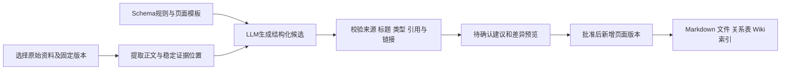
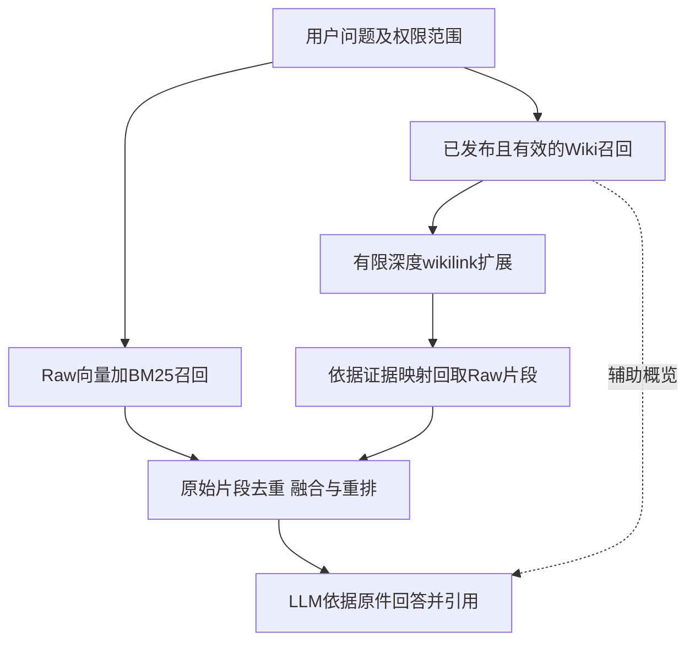

# MindPilot 三层知识结构与 RAG 整合设计

日期：2026-10-12。本文是实施设计，不表示所列新接口和表已经上线。

## 现状与目标

`frontend/src/views/WikiCenter.vue` 已有列表、来源、关联关系、修改历史和编译建议界面，但 `frontend/src/api/index.js` 中的 `wikiApi` 仍读取 `demoSeed`。真实工作台中另有 `WorkbenchEntry(kind=wiki)`，目前是手动内容，不能等同于已通过来源验证的编译页。

正式 RAG 的 `backend/app/tools/search_knowledge_base.py` 已使用原始资料的向量与 BM25 检索，再以 RRF 融合；`runtime_tools._rag` 会按所属用户与可用资料筛选。`documents.get_document` 当前返回空的 `relatedWiki`。应接通这些现有位置，而不是另造一套不关联的资料库。

Wiki 定位为可追溯的编译层：组织和压缩原始知识，辅助找到相关事实；不能将 LLM 的生成内容提升为新的原始事实。Schema 是应用可信配置，不作为待检索知识、不从上传文档执行。

## 1. 物理存放与职责

| 层级 | 内容 | 建议位置 | 当前基础 |
| --- | --- | --- | --- |
| Raw Sources | PDF/网页快照/笔记原件、来源地址、上传时间、SHA-256、来源版本 | 原件沿用 `backend/data/documents/`；新来源快照也属于业务数据 | `documents` 与 `document_chunks` |
| Wiki Layer | 实体/概念/主题/摘要/对比 Markdown，页面版本、链接、证据、编译建议 | `backend/data/wiki/<user-id>/pages/` 和 `revisions/`；元数据在业务数据库 | 现有 Wiki 前端和手动工作台 |
| Schema Layer | 编译指令、页面模板、验证规则和模式版本 | `.mindpoilt/wiki_schema/AGENTS.md`、`SCHEMA.md`、`templates/` | 尚需新增，属于配置区 |

编译作业的调度与工具执行记录可复用 `.mindpoilt` 的任务状态；产出的知识 Markdown、证据关系和业务版本仍保存于 `backend/data`。不得将登录资料、原始业务资料复制进会话记忆目录，也不得把模型密钥写进 Wiki。

“原件不可变”指编译与编辑不覆盖其字节：新版本生成新的快照，通过 `source_id` 与版本关联。用户仍可删除资料，删除时更新引用、撤销相关索引并标记依赖 Wiki 失效；不可变不代表无法执行删除和保留策略。

网页来源必须保存抓取时正文与原始URL；仅保存URL不能保证未来回查得到同一内容。人工笔记也作为有版本的来源，修改时生成新版本。

## 2. 数据模型

复用 Document 管理原件和上传授权，补充来源类型、内容哈希、逻辑来源ID、来源版本及原始URL。保留提取文本的规范化版本和页码，证据位置以固定提取版本为准；不能以重新分块后的临时位置冒充原件位置。

建议新增业务表：

| 表 | 必要字段与用途 |
| --- | --- |
| `wiki_pages` | `id/user_id/domain/title/type/status/current_revision/manual_protected`；唯一标识页面，状态含draft/published/stale |
| `wiki_revisions` | 不可变正文、摘要、版本号、Schema版本、编译模型、生成时间、操作者、人工/自动来源 |
| `wiki_evidence` | 页面版本、段落或声明ID、原始资料版本、chunk/page/start/end、原文摘要、来源哈希 |
| `wiki_links` | 来源页、目标页、关系与页面版本；wikilink解析结果，支持反向链接 |
| `wiki_proposals` | 编译候选、基准页面版本、来源版本清单、校验结果、差异、待确认/批准/拒绝状态 |

所有读写和检索以 `user_id` 为必要条件，知识域用于进一步缩小范围。页面标题用于显示，页面ID用于文件名和关系，防止同名页面和路径穿越。

手动工作台 Wiki 可以作为“人工笔记来源”参与编译，也可显式迁移为人工页面；没有来源校验时不能自动标为可作为事实依据的发布页。

## 3. Markdown 与 wikilink

示例格式：

```markdown
---
page_id: <stable-page-id>
type: concept
title: 向量检索
domain: personal_learning
revision: 3
schema_version: 1
status: published
---

# 向量检索

## 概述
通过向量表示检索语义相关片段。[S1]

## 关键事实
- 当前项目使用向量与BM25融合。[S2]

## 相关概念
[[Embedding]] · [[BM25]] · [[RRF融合]]

## 不确定性与冲突
记录来源未覆盖、来源之间不一致或仍需人工确认的内容。

## 来源
- [S1] 原始资料版本、页码、片段ID及定位
- [S2] 原始资料版本、页码、片段ID及定位
```

正文显示 `[[页面名称]]`，后台解析到同一用户、同一知识域的页面ID；可支持 `[[页面名称|显示文字]]`。解析时不得通过文件名拼接任意磁盘路径。同名冲突交给用户消歧；不存在的目标显示待创建链接，不能假装已有事实。反向链接由关系表生成，不让 LLM 自行维护两个方向。

## 4. 编译流程



1. 用户选择原始资料、页面类型、目标知识域和已配置文本模型。大文档按章节处理，禁止无提示截断后声称覆盖全文。
2. 读取可信 Schema 与固定模板，把来源作为明确分隔的“不可信资料”。资料内的指令不能更改工具权限、Schema或系统提示。
3. LLM 输出经过结构化验证的候选，不直接写正式页面。每个重要事实关联允许范围内的来源片段，禁止跨用户引用和编造source_id。
4. 校验标题、类型、模板章节、来源存在性、来源版本、引用覆盖和wikilink目标。结构通过不等于事实正确：重要结论保留可检查的原文，必要时增加独立模型评审。
5. 界面展示候选、差异、来源以及冲突，由用户批准或拒绝。人工保护页面只生成建议，不自动覆盖。
6. 批准时检查原始版本和基准页面版本仍一致；发生并发修改返回冲突并重新编译。新增版本后重建该页关系与索引。
7. 源文档更新或删除，依据证据依赖标记对应页面stale，排除旧页在默认事实检索中的使用。原始资料仍可直接检索。

来源存在性、哈希与版本、证据范围是确定性检查；LLM评审只是辅助。自动识别“矛盾”不可靠时，应明确标为待复核，不能静默择一合并。

## 5. 接入 RAG 的方式

不把 Raw 和 Wiki 混成一个无类型的向量集合。保留原始资料向量/BM25索引，新增独立 Wiki 向量/BM25索引，记录 `layer/page_id/revision/source_ids/status/domain/user_id`。配置层不建立问答索引。



Wiki用于发现主题、实体、别名和跨文档关系；其召回命中通过 `wiki_evidence` 回取原始片段。最终重排候选仍以Raw片段为单位，去重时不要把同一原始证据同时经Raw和Wiki出现的结果重复计算。

给LLM的上下文区分“原始证据”和“编译概览”：具体数字、日期、规范和冲突优先查原件。回答引用同时返回来源资料、页码和Wiki页面版本；原始证据不足时只能说明Wiki中的整理观点尚待核实，不能把Wiki文本作为独立事实佐证。

wikilink扩展初期最多1跳、最多5个页面，并受知识域、用户、有效版本、证据数量和token预算限制。Wiki编译内容变更只更新Wiki索引，不重建Raw索引；更换Embedding时分别管理两个索引的型号与维度。

没有已编译页面、Wiki索引异常、Schema不兼容或页面过期时，回退现有Raw检索，不能让Wiki故障阻断资料问答。

## 6. 前端和接口接入顺序

第一阶段：真实页面、不可变版本、Markdown全文编辑、来源列表、Schema查看、wikilink及反向链接；替换 `wikiApi` 的演示分支。现有摘要编辑不能冒充完整Wiki编辑。

第二阶段：新增编译按钮，选择来源与模板，后台任务、候选差异、批准/拒绝、人工保护、并发版本校验。接通知识资料详情的 `relatedWiki`。

第三阶段：Wiki独立索引与检索、链接扩展、回取Raw证据、RRF融合与重排，沿用现有 `hybrid_search` 工具出口和聊天引用格式。

建议接口：`GET /wiki/pages`、`GET /wiki/pages/{id}`、`PUT /wiki/pages/{id}`、`GET /wiki/pages/{id}/revisions`、`POST /wiki/compile`、`GET /wiki/proposals`、`POST /wiki/proposals/{id}/approve|reject`、`GET /wiki/schema`。写接口带期望版本；编译接口返回任务ID，可复用现有任务状态机制。

## 7. 评测与验收

在同一黄金数据集与相同生成/评审模型上比较：Raw-only、Wiki-only（仅用于观察错误，不建议作为最终事实链）、Raw+Wiki证据扩展。Wiki候选映射回Raw后再计算文档Recall/Precision/MRR/nDCG，不能将编译页当成另一份独立相关原件。

沿用现有Faithfulness、Groundedness、Factual Consistency、潜在幻觉率和逐句信号，新增来源可追溯覆盖率、断链率、过期页面引用数、发布前校验成功率、编译与检索耗时。跨用户来源不能出现在候选、关联页面或最终回答中。

必须验证：多来源冲突、短事实与数值、原件替换后页码变化、源文档删除、同名页面、Schema升级、人工保护、重复编译幂等、并发编辑和编译失败回退。不能用“页面更多”“图谱更大”代替事实可靠性提升。

## 8. 已实现的知识资料页入口（2026-10-12）

知识资料列表分别显示向量化状态（未向量化、向量化完成）与Wiki状态（未编译、编译完成）。上传后向量化与Wiki编译可独立启动，也可同时运行，互不要求对方先完成。执行中按钮旋转并展示批次进度，失败后允许重试，完成后可在资料预览的关联Wiki页签查看Markdown初稿。切换页面不取消任务，返回页面后从后端恢复状态。服务重启中断的任务标记失败，避免一直显示编译中。

`POST /api/v1/documents/{id}/wiki-compile` 使用已启用的文本模型，直接从原文件解析并建立独立片段快照，按每批8个片段编译（当前支持1至500个片段），不创建向量索引或修改向量化状态。编译规则首次写入配置目录下的 `wiki_schema/SCHEMA.md`，原始资料不会被修改；输出保留 `[S编号]` 对应的原文片段、页码、来源指纹及模型信息。片段ID由原文件指纹和片段序号组成，不依赖向量化任务的数据库分块ID。编译任务及结果保存在业务数据库的 `document_wiki_compilations` 表，Markdown另存于 `backend/data/wiki/<用户ID>/compiled/<资料ID>.md`。删除资料会清理编译结果，正在编译的资料需等待任务结束后删除。

本入口完成的是单资料编译初稿，不代表Wiki正式发布。正式页面版本、人工审核、跨资料合并及链接解析仍按前述方案后续实现。问答已接通下述Wiki与Raw并行检索。

## 9. Wiki与RAG的处理边界

两条流水线共享不可变原始资料及所有权信息，但拥有各自的任务状态、切分参数、输出和失败重试。Wiki自身负责原文解析清洗、结构切分、LLM概念/实体/关系抽取、按Schema生成或增量更新页面、合并去重、链接与反向链接、Markdown写回及lint巡检。RAG负责原文解析切分、Embedding、向量/关键词索引及检索重排。复用底层文件解析工具不代表依赖对方任务或结果。

当前Wiki使用独立的1000字片段预算，不读取RAG已生成的分块，也不沿用资料的向量化切分参数。用户可先编译Wiki、先向量化，或者同时启动两个任务。查询时才通过Wiki的来源映射联动原始证据；后续若建立Wiki检索索引，它属于检索接入流程，不作为Wiki编译的前置条件。

上述完整Wiki流水线是目标设计；当前已落地原始文件解析、独立片段快照、Schema约束下的分批Markdown初稿、引用编号校验、写回和持久化状态，并支持查询驱动的增量补充。结构化实体/关系抽取、多类型页面、跨资料页面合并、wikilink解析与反向链接、完整lint和发布审核尚未实现。

## 10. Wiki与Raw RAG融合查询（2026-10-12）

聊天统一通过 `knowledge_context` 同时启动两个独立检索线程。Wiki侧按问题关键词检索当前用户的编译正文，并通过 `[S编号]` 映射到保存的原文快照；仅使用文件指纹仍有效的内容，未向量化资料也可从Wiki侧命中。Raw侧沿用向量检索与BM25的排名融合。两个引擎独立失败回退，融合后按文档、页码和规范化原文去重，再进行RRF排序；已启用且可用的Reranker用于统一重排，失败保留RRF结果。

回答上下文同时含Wiki概览及原始证据。Wiki只帮助组织知识；事实与数字最终引用原文证据，避免将编译页作为第二份独立事实。聊天引用和检索记录带 `retrievalOrigins`、`wikiId` 和重排分数，界面显示“Wiki + RAG”或“Wiki → 原文”。

当Raw找到相关资料时，后台对每次查询最多两份资料检查Wiki覆盖情况。模型依据用户问题、当前Wiki及其他命中Wiki，判断是否需要补充；已有覆盖则不更新。补充只使用对应原件中校验过的Raw片段，严格检查引用编号及事实段落引用，不读取AI聊天回答。已有正文保留，新增知识插入来源目录之前，并维护来源快照和补充记录；没有Wiki时可建立来源绑定的查询补充初稿。来源变化或版本冲突时拒绝覆盖，失败不影响本次聊天。

后台任务独立保存在业务数据库 `wiki_supplement_jobs`，同资料同时只执行一个补充任务，相同问题及证据重复查询不重复执行成功/无需更新的任务。补充与完整Wiki编译共用独立Wiki线程池，与向量化线程池分开；切换页面不终止任务。服务重启中断任务标记失败，下次查询可重试。知识资料页显示后台补充状态及补充次数，结果在“关联Wiki”中查看。

本阶段仍是单资料Wiki初稿检索与知识积累：Wiki检索采用关键词与原文快照回取，尚未实现Wiki独立向量索引和知识图谱扩展。LLM对覆盖度与事实表述的判断仍可能有误，引用校验确保来源存在，并不等于已经证明每句话的事实一致性。
